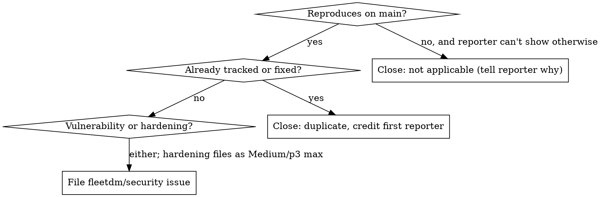

# Security report triage

You are the triage DRI. You receive reports, talk to reporters, and turn valid, non-duplicate findings into `fleetdm/security` issues that an Engineering Manager owns. You don't write fixes, publish advisories, pay bounties, or accept risk. Those are the CTO's calls; hand them up.

**Triage is done when** the report is either closed with a reason the reporter has seen, or filed as one `fleetdm/security` issue that has all of: `security` label, priority label, product group label, the group's EM assigned, a card on the group's board, and status **🥚 Ready** on the [:help-security board](https://github.com/orgs/fleetdm/projects/113). Anything short of that is still yours.

Handbook: [Handle a security report](https://fleetdm.com/handbook/engineering#handle-a-security-report). This skill is the how-to for that section; the handbook wins if they disagree.

**REQUIRED SUB-SKILL:** `bugbop:bugbop` for reading and writing Bugbop reports (plugin from the `bugbop-skills` marketplace). If the plugin isn't installed or the API write is blocked, use the Bugbop web UI; the result is what matters.

## Daily pass

Three intake channels. Check all three every business day; reports that only show up on one tab go dark for weeks.

```bash
# 1. Bugbop: anything new, or open with a hunter comment newer than ours (both programs)
python3 scripts/bugbop.py GET "/reports?status=new,open,needs_info" --all --summary
# 2. GitHub advisory submissions awaiting triage
gh api '/repos/fleetdm/fleet/security-advisories?state=triage&per_page=100' \
  -q '.[] | "\(.ghsa_id) \(.severity) \(.created_at[:10]) \(.author.login) comments=\(.comments) | \(.summary)"'
# 3. The security inbox (see the repository security policy for the address)
```

Acknowledge every new report within one business day, even if the only content is "received, reviewing." Use the acknowledgement in `replies.md`.

## Triage one report

1. **Read it skeptically.** Scanner and AI-written reports often describe fixed behavior, a nonexistent endpoint, or a privilege the attacker already holds. The report's own severity is a claim, not a rating.
2. **Dedup before anything else.** `gh search issues` misses body text, so dump and grep. Run the sweep in `reference.md` against `fleetdm/security` (open and closed), `fleetdm/confidential`, all advisories on `fleetdm/fleet` (triage, draft, published), both Bugbop programs, and the advisory running list. Search exact endpoint paths, parameter names, and function names, not the title.
3. **Verify against `main`.** Read the handler, the authz policy, and the datastore query the report names. Note the commit you checked. If the code was fixed, find the fixing PR with `git log -S` and the first release tag that contains it. Write down what you verified and what you did not.
4. **Classify and rate** with `severity.md`. Decide vulnerability vs. hardening first, then severity, then the matching priority label.
5. **Route** by outcome:



6. **File** with `issue-template.md`, one issue per distinct root cause, title `Report [Severity]: ...`. Labels: `security`, `p0`..`p4`, `#g-<group>`. Assign the group's EM (look them up on the [product groups page](https://fleetdm.com/handbook/company/product-groups)). Add the issue to the group's board and set the :help-security card to **🥚 Ready**. Commands in `reference.md`.
7. **Reconcile the source.** Bugbop: status `open`, severity set to Fleet's rating, internal note with the issue URL. GitHub advisory: accept as draft, set Fleet's severity, affected range, credits, template description. Post the validated reply from `replies.md`.
8. **Customer identity never enters `fleetdm/security`.** Codenames and `customer-<codename>` labels are fine; real names, domains, and screenshots with identifying data go in `fleetdm/confidential`, linked from the issue.

## After hand-off, still yours

- Reporter updates when the fix merges (name the target release) and when it ships (name the release). Bugbop status to `fixed` only after it ships.
- When a fix merges: close the `fleetdm/security` issue with the PR link, move its board cards back to the release QA column (the close automation sends them to Done), and add the advisory follow-up row to the running list in `fleetdm/confidential` (search issues for "advisory running list").
- Advisory publishing, CVE requests, bounty amounts, severity disputes you can't settle, Critical or p1 ratings, and anything naming a customer: bring to the CTO with a one-paragraph summary and your recommendation.

## Quick reference

| Question | Answer |
|---|---|
| Critical / High / Medium / Low | `p0` / `p2` / `p3` / `p4`. `p1` only when the CTO sets it. |
| Bugbop statuses | `new`, `open`, `needs_info`, `fixed`, `wont_fix`, `duplicate`, `not_applicable`. `duplicate` needs a `duplicate_of_id` in the same program. |
| Duplicate across Bugbop programs | Can't be linked. Leave the later one `open` with an internal note, tell the reporter, close as `fixed` with the tracker when it ships. |
| Accept an advisory submission | `PATCH .../security-advisories/{ghsa} state=draft`. Severity and CVSS vector can't be set in one call; send the vector alone. |
| Advisory comments | No API. Post in the GitHub UI, signed in. |
| Bounties | VDP pays none; offer advisory credit and swag. The private program's amounts are set by the CTO in the Bugbop UI. |
| Reporter wants a CVE or a date | Don't promise either. CVEs are requested at publish; publish happens two minor releases after the fix ships. |

## Common mistakes

- Replying with "validated" or a severity before reading the code. Acknowledge first, rate after.
- Dedup by title search only. Three reporters, three titles, one bug.
- Filing with the reporter's severity. Rate it yourself; note the change in the issue.
- A security issue with no `p*` label or no assignee. Compliance tracking and the SLA digest don't see it.
- Filing a report that doesn't reproduce "just in case." Filing starts an SLA clock.
- Describing the vulnerability in the public repo: PR titles, commit messages, `changes/` files, branch names. Neutral wording there; detail stays in the private issue.
- Closing a Bugbop report as `fixed` at merge time. The reporter reads that as "shipped."
- Pasting a customer's name into `fleetdm/security` because "the repo is private."
