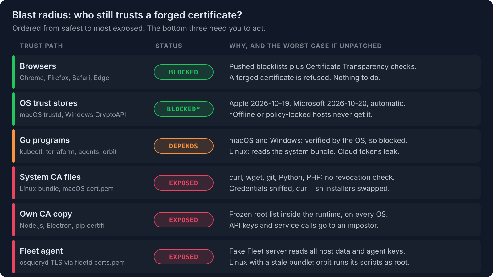
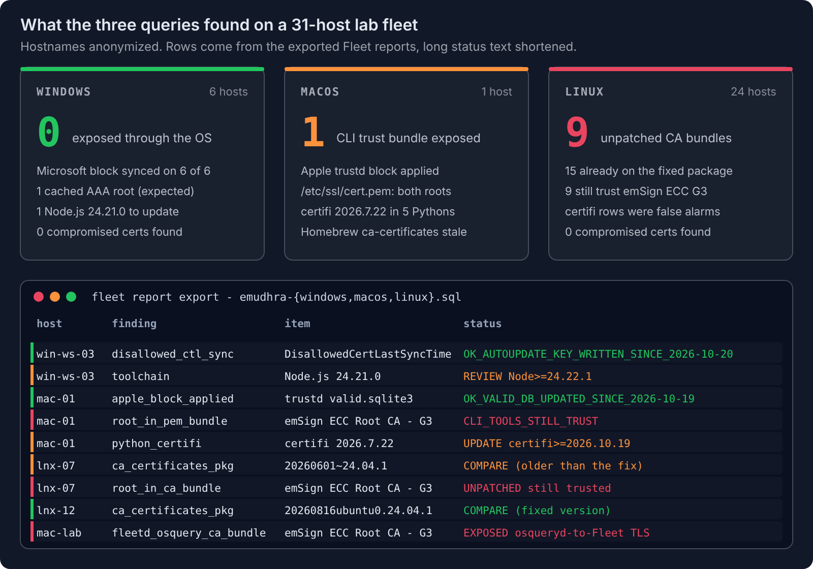

# eMudhra CA key compromise: find and fix the trust stores your browser doesn't cover

*Browsers and operating systems blocked the compromised eMudhra intermediates within days. Your CLI tools, runtimes, and Fleet's own agent kept their old copy of the trusted roots. Here is how to find those hosts and fix them with Fleet.*

## Key takeaways

- **The vendor blocks don't reach every trust store.** Chrome, Firefox, Apple, and Microsoft blocked the eight intermediates by 20 October. Anything that ships a frozen file of trusted roots still accepts certificates they sign.
- **Exposure depends on which trust path a program uses.** curl and git on Linux and macOS, Node.js, Electron, pip-installed certifi, and Go programs on Linux each need their own fix. Signed package installs through apt or dnf stay safe.
- **Fleet's agent carries its own CA bundle too.** Enrolled hosts keep the bundle written at install time. A fix is merged in Fleet's source, but existing hosts still need the file cleaned.
- **One report per OS shows where each host stands.** Each report returns a row per finding, so a single run tells you which hosts still trust the roots and which ones received the vendor block.
- **Policies and scripts close the gap without a manual sweep.** A failing policy runs the matching script. The script edits only what it can prove is safe, and the host turns green on its own.
- **Two public test hosts confirm the fix.** A protected client refuses both. A `200` means that client still trusts the forged chain.

<a purpose="cta-button" href="/vulnerability-management">See vulnerability management in Fleet</a>

In April 2025, eMudhra generated eight intermediate CA private keys that were [integers smaller than 256](https://bugzilla.mozilla.org/show_bug.cgi?id=2083449). A private key is supposed to be a random 384-bit number. Anyone can try every value below 256 in milliseconds. Whoever recomputes one of these keys can sign a certificate for any hostname, and every client that trusts the parent root accepts it.

Six of the intermediates issue TLS certificates and two sign code. A researcher reported the keys on 17 October 2026, and eMudhra revoked all eight on 18 October. The browser and OS vendors moved fast. The open question is which of your hosts never got their fix.

## What happened

Every HTTPS connection relies on a chain of trust. A device holds a short list of root certificates. A root vouches for an intermediate, and the intermediate signs the certificate a website presents. If the chain checks out, the device trusts the site.

The TLS intermediates chain to `emSign ECC Root CA - G3`, the root most devices trust. Every one of the eight also has a twin cross-signed by Sectigo's `AAA Certificate Services` root. That gives 16 certificates to distrust and two roots to remove from any CA file that still carries them.


## Why it still needs action

Chrome and Firefox pushed blocks on 17 October, Apple on 19 October, and Microsoft on 20 October ([disclosure site](https://emudhra.we-have-a-problem.com/)). Google [found](https://blog.google/security/protecting-chrome-and-android-users-from-compromised-emudhra-intermediate-ca-certificates/) no TLS certificate under these intermediates in Certificate Transparency logs before its block.

Those fixes reach software that asks the OS or checks revocation. A lot of software does neither. It ships a frozen file of trusted roots and believes it until someone updates the file. That is where the remaining risk sits.

## Blast radius

An attacker still needs a position on the network path to use a forged certificate: rogue Wi-Fi, a compromised router or proxy, or DNS hijacking. With that position, here is what each trust path gives them.



| Trust path | Fixed by the vendor push? | Worst case if left unpatched |
|---|---|---|
| curl, wget, git, and scripts (Linux CA bundle, macOS `/etc/ssl/cert.pem`) | No. Apple did not update `/etc/ssl/cert.pem`. | Passwords and API tokens read in transit. `curl \| sh` installers swapped for malware. Package installs through apt or dnf stay safe because packages are GPG-signed. |
| System-wide on Linux (unpatched `ca-certificates`) | Only after a package update. On 21 October, Rocky Linux 9 and Fedora 44 stable repos still shipped the root. | Every OpenSSL or GnuTLS program on the host can be impersonated at once: backups, webhooks, monitoring agents, and database clients. |
| Go programs | macOS and Windows: yes, Go asks the OS ([docs](https://pkg.go.dev/crypto/x509)). Linux: no, Go reads the system bundle. | Cloud CLIs, `kubectl`, and `terraform` hand their credentials to an impostor API. [Go 1.27.3 and 1.26.10](https://go.dev/doc/devel/release) reject these keys outright, but only after a rebuild. |
| Node.js and Electron | No. Official builds ship a [bundled Mozilla snapshot](https://nodejs.org/api/cli.html#--use-bundled-ca---use-openssl-ca) fixed at release, on every OS. | Service-to-service calls and API keys go to the attacker, even on a fully patched Mac or Windows host. Fixed in Node.js 22.23.4, 24.22.1, and 26.12.1, and Electron 42.11.16, 43.8.1, and 44.9.1. |
| Python `requests` (pip-installed `certifi`) | No. certifi is its own CA copy. | Same as Node.js. Fixed in certifi 2026.10.19. Distro-packaged certifi points at the system bundle and follows it. |
| Windows code signing (two code-signing intermediates) | Yes, through Microsoft's disallowed list, if the host received it. | Malware signed "by eMudhra" passes checks that only ask whether a binary has a trusted signature. |

### Fleet's own agent

Fleet's agent ships its own CA bundle at `/opt/orbit/certs.pem` (`C:\Program Files\Orbit\certs.pem` on Windows). `osqueryd` uses that file, not the OS store, for every TLS connection to the Fleet server. The file is written at install time and is not refreshed afterwards.

Fleet merged a change that drops the emSign roots from that bundle on 21 October ([fleetdm/fleet#56173](https://github.com/fleetdm/fleet/pull/56173)). The bundle is embedded in `fleetctl package`, so only packages built with a `fleetctl` release that includes the change will ship it. Hosts that are already enrolled keep their old file either way.

Orbit, the updater, is written in Go. On macOS and Windows it verifies TLS through the OS, so the vendor block covers it. On Linux it reads the system bundle.

The worst case is an impostor Fleet server. It collects every host's report results and node keys, and it can run its own queries. On a Linux host whose system bundle is also stale, orbit would accept that server too. If scripts are enabled, orbit runs the scripts it receives as root.

## Detect: one report per OS

Each report returns four columns: `finding`, `item`, `detail`, and `status`. There is one row per signal. No row for a finding means it was not found.

| Finding | What it means |
|---|---|
| `compromised_intermediate_present` | One of the 16 revoked certificates sits in a local store. Investigate who put it there. |
| `root_in_ca_bundle` / `root_in_pem_bundle` | A system CA file still trusts a compromised root. Command-line tools are exposed. |
| `fleetd_osquery_ca_bundle` | Fleet's agent bundle still trusts a compromised root. Traffic from the agent to Fleet is exposed. |
| `apple_block_applied` / `disallowed_ctl_sync` | The Apple or Microsoft block landed. `STALE` or `NOT_SYNCED` means it did not. |
| `disallowed_store_block` | Windows only: how many of the 16 certificates the remediation script has explicitly distrusted. |
| `ctl_autoupdate_policy` | Group Policy blocks Microsoft's automatic distrust updates. |
| `ca_certificates_pkg`, `homebrew_ca_certificates`, `python_certifi`, `toolchain` | Package and runtime versions to compare against the fixed versions above. |
| `go_binary` | A Go tool in a user's `go/bin` built with Go older than 1.27.3 or 1.26.10. |
| `root_in_keychain` / `root_in_cert_store`, `fleetd_agent`, `host` | Informational. Apple and Microsoft ship both roots on every device and block the intermediates instead, so these rows stay after the fix. |

Paste the SQL from a block below into a live report in the Fleet UI. To keep the reports in GitOps, use [`emudhra-ca-compromise.reports.yml`](https://github.com/fleetdm/fleet/blob/main/docs/solutions/all/reports/emudhra-ca-compromise.reports.yml). It holds the same three queries with a daily interval. Once saved, run one on demand with `fleetctl`:

```bash
fleetctl report --report-name "macOS - eMudhra CA compromise exposure" --labels "macOS"
```

<details>
<summary>macOS report</summary>

```sql
SELECT 'root_in_keychain' AS finding, common_name AS item, path AS detail,
       CASE sha1
         WHEN '3043fa4ff257dca0c380ee2e58ea78b23fe6bbc1' THEN 'ROOT_TRUSTED emSign ECC Root CA - G3 (Apple root store; Apple block via trustd)'
         WHEN 'd1eb23a46d17d68fd92564c2f1f1601764d8e349' THEN 'ROOT_TRUSTED AAA Certificate Services (Sectigo cross-sign path)'
         ELSE 'ROOT_TRUSTED emSign Root TLS/CS CA - G3 (not in Apple store by default; manually added)'
       END AS status
FROM certificates
WHERE sha1 IN ('3043fa4ff257dca0c380ee2e58ea78b23fe6bbc1',
               'd1eb23a46d17d68fd92564c2f1f1601764d8e349',
               '39d3236e4a609ab6190cbfa1ad02b3cc61dfc2c3',
               '1f74b6010a219fd9ca058d07aa053d15efd9300d')
UNION ALL
-- /etc/ssl/cert.pem is used by Apple-shipped curl, git, python3, ruby, perl, openssl. Apple did NOT update it.
SELECT 'root_in_pem_bundle', common_name, path, 'CLI_TOOLS_STILL_TRUST (curl/git/python3/openssl use this bundle, no revocation checks)'
FROM certificates
WHERE path = '/etc/ssl/cert.pem'
  AND sha1 IN ('3043fa4ff257dca0c380ee2e58ea78b23fe6bbc1',
               'd1eb23a46d17d68fd92564c2f1f1601764d8e349')
UNION ALL
SELECT 'compromised_intermediate_present', common_name, path || ' sha1=' || sha1, 'IOC_HIT investigate'
FROM certificates
WHERE subject_key_id IN ('e21e2fe71c19390e554b62c120245735248a2514',  -- EM DV TLS CA - G3B
                         '9bd86551afe7e72c37ad08ee6919d9bf3784ae0a',  -- EM OV TLS CA - G3B
                         '3edc20d9894698877b873fd88147b25c15d84706',  -- EM EV TLS CA - G3B
                         'ae7e105c3c2996c1a847270559f1e03dd4e50af3',  -- EM DV TLS CA - G3C
                         '34eaea0cebc90adaf9d0c5e2ed9b78c9879e1b6c',  -- EM OV TLS CA - G3C
                         'a6255e80a94db7f3967c1bc791df92bcee4beb5f',  -- EM EV TLS CA - G3C
                         '79fae8eccfdb0d758da458d69fb6eddc7c49dee6',  -- EM OV CS CA - G3B
                         'ee6f73298d6fbfa7b31bc39534f61556447866b7') -- EM OV CS CA - G3C
   OR sha1 IN ('a99b289464f3b44343270a7a1e910f02370483fe','1396be1372bc93dfa2a433ca964dba91548a6e57',
               '5f014e0db3bb8f950e0598ab280846d383fc57be','5dfa19197d1c1cf629af7c0cd865543c5050227c',
               'f33acd1f5d31aa81ac18c72c928446226d3d5914','19069bd6533bff93fb67c71fb3376b4ea7402c3b',
               '8ad23bc78845d6faae1d534bac89f0e36ba55a11','4b0944c14f8c2ccba4e4f32104ad920fa15ee331',
               '7fcc31aab874ce6c8ee8584f54cfd08646b54117','305fc1e253dcab71b95d4995dae3cb09d562f22a',
               'c988f3d0cc1629ffc43165d6464c9b6ef73d6e48','8588708e875a1f8aa83524f3559080f7e17068c7',
               'd33195a244046a3263fb5e0e83c6803a5b2e7bc3','ee26d7ae3cc71718f6e07d7d0095076f0c158f63',
               '1f4a5d178f8b6a8ef0f6784155bd5fea91158b12','7fde64753a957b98f172fd2ab0d922551909c7ba')
UNION ALL
-- Apple shipped the block on 2026-10-19 through trustd's "Valid" database (not a keychain change).
SELECT 'apple_block_applied', 'trustd valid.sqlite3', datetime(mtime, 'unixepoch') || 'Z',
       CASE WHEN mtime >= 1792368000 THEN 'OK_VALID_DB_UPDATED_SINCE_2026-10-19'
            ELSE 'STALE_NO_APPLE_BLOCK (offline or MobileAsset blocked)' END
FROM file
WHERE path = '/private/var/protected/trustd/valid.sqlite3'
UNION ALL
SELECT 'homebrew_ca_certificates', name, version,
       CASE WHEN version >= '2026-09-25_1' THEN 'FIXED' ELSE 'UPDATE brew upgrade ca-certificates' END
FROM homebrew_packages
WHERE name = 'ca-certificates'
UNION ALL
SELECT 'python_certifi', name || ' uid=' || uid, version || ' ' || path,
       CASE WHEN CAST(substr(version, 1, 4) AS INTEGER) * 10000
               + CAST(substr(version, 6, instr(substr(version, 6), '.') - 1) AS INTEGER) * 100
               + CAST(substr(version, 6 + instr(substr(version, 6), '.')) AS INTEGER) >= 20261019
            THEN 'FIXED' ELSE 'UPDATE certifi>=2026.10.19' END
FROM python_packages
WHERE name = 'certifi'
UNION ALL
SELECT 'toolchain', name, version, 'REVIEW Go>=1.27.3/1.26.10, Node>=22.23.4/24.22.1/26.12.1 (binaries built earlier stay vulnerable)'
FROM homebrew_packages
WHERE name IN ('go', 'node')
UNION ALL
-- fleetd ships its own CA bundle. osqueryd uses it (not the OS trust store) for TLS to Fleet.
-- It is written at install time and never refreshed, so the OS vendor block does not cover it.
SELECT 'fleetd_osquery_ca_bundle', common_name, path,
       'EXPOSED osqueryd-to-Fleet TLS trusts this root; run the remediation script'
FROM certificates
WHERE path = '/opt/orbit/certs.pem'
  AND sha1 IN ('3043fa4ff257dca0c380ee2e58ea78b23fe6bbc1', 'd1eb23a46d17d68fd92564c2f1f1601764d8e349')
UNION ALL
SELECT 'fleetd_agent', 'orbit ' || version, 'channel=' || orbit_channel || ' scripts_enabled=' || scripts_enabled,
       'INFO orbit is Go; on macOS it verifies TLS through the OS, so the Apple block applies'
FROM orbit_info
UNION ALL
-- Go tools installed with go install (each user's ~/go/bin).
SELECT 'go_binary', name || ' ' || version, installed_path || ' ' || go_version,
       CASE WHEN CAST(substr(go_version, 5) AS INTEGER) >= 28
              OR (CAST(substr(go_version, 5) AS INTEGER) = 27 AND CAST(substr(go_version, 8) AS INTEGER) >= 3)
              OR (CAST(substr(go_version, 5) AS INTEGER) = 26 AND CAST(substr(go_version, 8) AS INTEGER) >= 10)
            THEN 'FIXED_GO'
            ELSE 'REBUILD with Go>=1.27.3/1.26.10' END
FROM go_binaries
UNION ALL
SELECT 'host', name, version || ' (' || build || ')', 'INFO'
FROM os_version;
```

</details>

<details>
<summary>Linux report</summary>

```sql
SELECT 'root_in_ca_bundle' AS finding, common_name AS item, path AS detail,
       CASE sha1
         WHEN '3043fa4ff257dca0c380ee2e58ea78b23fe6bbc1' THEN 'UNPATCHED emSign ECC Root CA - G3 still trusted (fixed ca-certificates removes it)'
         WHEN 'd1eb23a46d17d68fd92564c2f1f1601764d8e349' THEN 'AAA Certificate Services trusted: Sectigo cross-sign path open (Mozilla-derived bundles no longer ship it; old bundle or manually added)'
         ELSE 'emSign Root TLS/CS CA - G3 present (not in Mozilla bundle; manually added)'
       END AS status
FROM certificates
WHERE sha1 IN ('3043fa4ff257dca0c380ee2e58ea78b23fe6bbc1',
               'd1eb23a46d17d68fd92564c2f1f1601764d8e349',
               '39d3236e4a609ab6190cbfa1ad02b3cc61dfc2c3',
               '1f74b6010a219fd9ca058d07aa053d15efd9300d')
UNION ALL
SELECT 'compromised_intermediate_present', common_name, path || ' sha1=' || sha1, 'IOC_HIT investigate'
FROM certificates
WHERE subject_key_id IN ('e21e2fe71c19390e554b62c120245735248a2514',  -- EM DV TLS CA - G3B
                         '9bd86551afe7e72c37ad08ee6919d9bf3784ae0a',  -- EM OV TLS CA - G3B
                         '3edc20d9894698877b873fd88147b25c15d84706',  -- EM EV TLS CA - G3B
                         'ae7e105c3c2996c1a847270559f1e03dd4e50af3',  -- EM DV TLS CA - G3C
                         '34eaea0cebc90adaf9d0c5e2ed9b78c9879e1b6c',  -- EM OV TLS CA - G3C
                         'a6255e80a94db7f3967c1bc791df92bcee4beb5f',  -- EM EV TLS CA - G3C
                         '79fae8eccfdb0d758da458d69fb6eddc7c49dee6',  -- EM OV CS CA - G3B
                         'ee6f73298d6fbfa7b31bc39534f61556447866b7') -- EM OV CS CA - G3C
   OR sha1 IN ('a99b289464f3b44343270a7a1e910f02370483fe','1396be1372bc93dfa2a433ca964dba91548a6e57',
               '5f014e0db3bb8f950e0598ab280846d383fc57be','5dfa19197d1c1cf629af7c0cd865543c5050227c',
               'f33acd1f5d31aa81ac18c72c928446226d3d5914','19069bd6533bff93fb67c71fb3376b4ea7402c3b',
               '8ad23bc78845d6faae1d534bac89f0e36ba55a11','4b0944c14f8c2ccba4e4f32104ad920fa15ee331',
               '7fcc31aab874ce6c8ee8584f54cfd08646b54117','305fc1e253dcab71b95d4995dae3cb09d562f22a',
               'c988f3d0cc1629ffc43165d6464c9b6ef73d6e48','8588708e875a1f8aa83524f3559080f7e17068c7',
               'd33195a244046a3263fb5e0e83c6803a5b2e7bc3','ee26d7ae3cc71718f6e07d7d0095076f0c158f63',
               '1f4a5d178f8b6a8ef0f6784155bd5fea91158b12','7fde64753a957b98f172fd2ab0d922551909c7ba')
UNION ALL
-- Fixed: Ubuntu 20260816ubuntu0.{22.04,24.04,26.04,26.10}.1, Debian 20250419~deb12u2 / 20250419+deb13u1, Fedora 2026.2.92_v9.0.319, Alpine 20261020-r0
SELECT 'ca_certificates_pkg', name, version || ' status=' || status, 'COMPARE to fixed version for this distro'
FROM deb_packages
WHERE name = 'ca-certificates'
UNION ALL
SELECT 'ca_certificates_pkg', name, version || '-' || release, 'COMPARE to fixed version for this distro'
FROM rpm_packages
WHERE name = 'ca-certificates'
UNION ALL
SELECT 'python_certifi', name || ' uid=' || uid, version || ' ' || path,
       -- Distro-packaged certifi points at the system bundle (Debian/Ubuntu dist-packages, Fedora/RHEL site-packages).
       CASE WHEN path LIKE '/usr/lib/python3/dist-packages%'
              OR path LIKE '/usr/lib/python3%/site-packages%'
              OR path LIKE '/usr/lib64/python3%/site-packages%'
            THEN 'OK_DISTRO_CERTIFI (patched to use system bundle; see ca_certificates_pkg)'
            WHEN CAST(substr(version, 1, 4) AS INTEGER) * 10000
               + CAST(substr(version, 6, instr(substr(version, 6), '.') - 1) AS INTEGER) * 100
               + CAST(substr(version, 6 + instr(substr(version, 6), '.')) AS INTEGER) >= 20261019
            THEN 'FIXED' ELSE 'UPDATE certifi>=2026.10.19' END
FROM python_packages
WHERE name = 'certifi'
UNION ALL
SELECT 'toolchain', name, version, 'REVIEW Go>=1.27.3/1.26.10, Node>=22.23.4/24.22.1/26.12.1 (binaries built earlier stay vulnerable)'
FROM deb_packages
WHERE name IN ('golang-go', 'nodejs')
UNION ALL
SELECT 'toolchain', name, version || '-' || release, 'REVIEW Go>=1.27.3/1.26.10, Node>=22.23.4/24.22.1/26.12.1'
FROM rpm_packages
WHERE name IN ('golang', 'nodejs')
UNION ALL
-- fleetd ships its own CA bundle. osqueryd uses it (not the OS trust store) for TLS to Fleet.
-- It is written at install time and never refreshed, so the OS vendor block does not cover it.
SELECT 'fleetd_osquery_ca_bundle', common_name, path,
       'EXPOSED osqueryd-to-Fleet TLS trusts this root; run the remediation script'
FROM certificates
WHERE path = '/opt/orbit/certs.pem'
  AND sha1 IN ('3043fa4ff257dca0c380ee2e58ea78b23fe6bbc1', 'd1eb23a46d17d68fd92564c2f1f1601764d8e349')
UNION ALL
SELECT 'fleetd_agent', 'orbit ' || version, 'channel=' || orbit_channel || ' scripts_enabled=' || scripts_enabled,
       'INFO orbit is Go; on Linux it reads the system bundle, so it is safe only once root_in_ca_bundle rows are gone'
FROM orbit_info
UNION ALL
-- Go tools installed with go install (each user's ~/go/bin).
SELECT 'go_binary', name || ' ' || version, installed_path || ' ' || go_version,
       CASE WHEN CAST(substr(go_version, 5) AS INTEGER) >= 28
              OR (CAST(substr(go_version, 5) AS INTEGER) = 27 AND CAST(substr(go_version, 8) AS INTEGER) >= 3)
              OR (CAST(substr(go_version, 5) AS INTEGER) = 26 AND CAST(substr(go_version, 8) AS INTEGER) >= 10)
            THEN 'FIXED_GO'
            ELSE 'REBUILD with Go>=1.27.3/1.26.10' END
FROM go_binaries
UNION ALL
SELECT 'host', name, version || ' ' || platform_like, 'INFO'
FROM os_version;
```

</details>

<details>
<summary>Windows report</summary>

```sql
SELECT 'root_in_cert_store' AS finding, common_name AS item,
       store_location || '\' || store || ' user=' || username AS detail,
       CASE sha1
         WHEN '3043fa4ff257dca0c380ee2e58ea78b23fe6bbc1' THEN 'ROOT_TRUSTED emSign ECC Root CA - G3'
         WHEN 'd1eb23a46d17d68fd92564c2f1f1601764d8e349' THEN 'ROOT_TRUSTED AAA Certificate Services (Sectigo cross-sign path)'
         WHEN '39d3236e4a609ab6190cbfa1ad02b3cc61dfc2c3' THEN 'ROOT_TRUSTED emSign Root TLS CA - G3 (Microsoft root store)'
         ELSE 'ROOT_TRUSTED emSign Root CS CA - G3 (Microsoft root store, code signing)'
       END AS status
FROM certificates
WHERE sha1 IN ('3043fa4ff257dca0c380ee2e58ea78b23fe6bbc1',
               'd1eb23a46d17d68fd92564c2f1f1601764d8e349',
               '39d3236e4a609ab6190cbfa1ad02b3cc61dfc2c3',
               '1f74b6010a219fd9ca058d07aa053d15efd9300d')
UNION ALL
SELECT 'compromised_intermediate_present', common_name,
       store_location || '\' || store || ' user=' || username || ' sha1=' || sha1, 'IOC_HIT investigate (cached intermediate or code-signing chain seen)'
FROM certificates
WHERE store <> 'Untrusted Certificates'
  AND (subject_key_id IN ('e21e2fe71c19390e554b62c120245735248a2514',  -- EM DV TLS CA - G3B
                         '9bd86551afe7e72c37ad08ee6919d9bf3784ae0a',  -- EM OV TLS CA - G3B
                         '3edc20d9894698877b873fd88147b25c15d84706',  -- EM EV TLS CA - G3B
                         'ae7e105c3c2996c1a847270559f1e03dd4e50af3',  -- EM DV TLS CA - G3C
                         '34eaea0cebc90adaf9d0c5e2ed9b78c9879e1b6c',  -- EM OV TLS CA - G3C
                         'a6255e80a94db7f3967c1bc791df92bcee4beb5f',  -- EM EV TLS CA - G3C
                         '79fae8eccfdb0d758da458d69fb6eddc7c49dee6',  -- EM OV CS CA - G3B
                         'ee6f73298d6fbfa7b31bc39534f61556447866b7') -- EM OV CS CA - G3C
   OR sha1 IN ('a99b289464f3b44343270a7a1e910f02370483fe','1396be1372bc93dfa2a433ca964dba91548a6e57',
               '5f014e0db3bb8f950e0598ab280846d383fc57be','5dfa19197d1c1cf629af7c0cd865543c5050227c',
               'f33acd1f5d31aa81ac18c72c928446226d3d5914','19069bd6533bff93fb67c71fb3376b4ea7402c3b',
               '8ad23bc78845d6faae1d534bac89f0e36ba55a11','4b0944c14f8c2ccba4e4f32104ad920fa15ee331',
               '7fcc31aab874ce6c8ee8584f54cfd08646b54117','305fc1e253dcab71b95d4995dae3cb09d562f22a',
               'c988f3d0cc1629ffc43165d6464c9b6ef73d6e48','8588708e875a1f8aa83524f3559080f7e17068c7',
               'd33195a244046a3263fb5e0e83c6803a5b2e7bc3','ee26d7ae3cc71718f6e07d7d0095076f0c158f63',
               '1f4a5d178f8b6a8ef0f6784155bd5fea91158b12','7fde64753a957b98f172fd2ab0d922551909c7ba'))
UNION ALL
-- Explicit block added by remediate-emudhra-ca-compromise-windows.ps1. "Untrusted Certificates" is the English
-- display name of the Disallowed store. Microsoft's own CTL block does not show up here.
SELECT 'disallowed_store_block', COUNT(DISTINCT sha1) || ' of 16 compromised intermediates',
       'LocalMachine\Untrusted Certificates',
       CASE WHEN COUNT(DISTINCT sha1) = 16 THEN 'OK_EXPLICITLY_DISTRUSTED'
            ELSE 'NOT_PRESENT run the remediation script for an explicit block' END
FROM certificates
WHERE store_location = 'LocalMachine'
  AND store = 'Untrusted Certificates'
  AND sha1 IN ('a99b289464f3b44343270a7a1e910f02370483fe','1396be1372bc93dfa2a433ca964dba91548a6e57',
               '5f014e0db3bb8f950e0598ab280846d383fc57be','5dfa19197d1c1cf629af7c0cd865543c5050227c',
               'f33acd1f5d31aa81ac18c72c928446226d3d5914','19069bd6533bff93fb67c71fb3376b4ea7402c3b',
               '8ad23bc78845d6faae1d534bac89f0e36ba55a11','4b0944c14f8c2ccba4e4f32104ad920fa15ee331',
               '7fcc31aab874ce6c8ee8584f54cfd08646b54117','305fc1e253dcab71b95d4995dae3cb09d562f22a',
               'c988f3d0cc1629ffc43165d6464c9b6ef73d6e48','8588708e875a1f8aa83524f3559080f7e17068c7',
               'd33195a244046a3263fb5e0e83c6803a5b2e7bc3','ee26d7ae3cc71718f6e07d7d0095076f0c158f63',
               '1f4a5d178f8b6a8ef0f6784155bd5fea91158b12','7fde64753a957b98f172fd2ab0d922551909c7ba')
UNION ALL
-- Microsoft's 2026-10-20 block ships through the Disallowed CTL auto-update (CTL Updater), not Windows Update.
SELECT 'ctl_autoupdate_policy', name, 'data=' || data,
       CASE WHEN name = 'DisableRootAutoUpdate' AND data = '1' THEN 'BLOCK_WILL_NOT_ARRIVE auto root update disabled by policy'
            WHEN name = 'EnableDisallowedCertAutoUpdate' AND data = '0' THEN 'BLOCK_WILL_NOT_ARRIVE disallowed CTL update disabled by policy'
            ELSE 'OK' END
FROM registry
WHERE key = 'HKEY_LOCAL_MACHINE\SOFTWARE\Policies\Microsoft\SystemCertificates\AuthRoot'
  AND name IN ('DisableRootAutoUpdate', 'EnableDisallowedCertAutoUpdate')
UNION ALL
SELECT 'disallowed_ctl_sync', name, 'key_mtime=' || datetime(mtime, 'unixepoch') || 'Z',
       CASE WHEN mtime >= 1792454400 THEN 'OK_AUTOUPDATE_KEY_WRITTEN_SINCE_2026-10-20'
            ELSE 'NOT_SYNCED_SINCE_BLOCK (offline, WSUS-only, or policy)' END
FROM registry
WHERE key = 'HKEY_LOCAL_MACHINE\SOFTWARE\Microsoft\SystemCertificates\AuthRoot\AutoUpdate'
  AND name IN ('DisallowedCertLastSyncTime', 'LastSyncTime')
UNION ALL
SELECT 'python_certifi', name || ' uid=' || uid, version || ' ' || path,
       CASE WHEN CAST(substr(version, 1, 4) AS INTEGER) * 10000
               + CAST(substr(version, 6, instr(substr(version, 6), '.') - 1) AS INTEGER) * 100
               + CAST(substr(version, 6 + instr(substr(version, 6), '.')) AS INTEGER) >= 20261019
            THEN 'FIXED' ELSE 'UPDATE certifi>=2026.10.19' END
FROM python_packages
WHERE name = 'certifi'
UNION ALL
SELECT 'toolchain', name, version, 'REVIEW Go>=1.27.3/1.26.10, Node>=22.23.4/24.22.1/26.12.1 (binaries built earlier stay vulnerable)'
FROM programs
WHERE name LIKE 'Go Programming Language%' OR name = 'Node.js'
UNION ALL
-- fleetd ships its own CA bundle. osqueryd uses it (not the Windows store) for TLS to Fleet.
-- Windows osquery cannot parse PEM files, so match one unique line from each root
-- (fleetd bundles wrap at 76 columns). The join skips hosts without the file.
SELECT 'fleetd_osquery_ca_bundle',
       CASE WHEN l.line LIKE 'CBeQyh%' THEN 'emSign ECC Root CA - G3' ELSE 'AAA Certificate Services' END,
       l.path, 'EXPOSED osqueryd-to-Fleet TLS trusts this root; run the remediation script'
FROM file f
JOIN file_lines l ON l.path = f.path
WHERE f.path = 'C:\Program Files\Orbit\certs.pem'
  AND l.line IN ('CBeQyh+KTOgNG3qxrdWBCUfvO6wIBHxcmbHtRwfSAjEAnbpV/KlK6O3t5nYBQnvI+GDZjVGLVTv7',
                 '8VlIMCFlA2zs6SFz7JsDoeA3raAVGI/6ugLOpyypEBMs1OUIJqsil2D4kF501KKaU73yqWjgom7C')
UNION ALL
SELECT 'fleetd_agent', 'orbit ' || version, 'channel=' || orbit_channel || ' scripts_enabled=' || scripts_enabled,
       'INFO orbit is Go; on Windows it verifies TLS through the OS, so the Microsoft block applies'
FROM orbit_info
UNION ALL
-- Go tools installed with go install (each user's go\bin).
SELECT 'go_binary', name || ' ' || version, installed_path || ' ' || go_version,
       CASE WHEN CAST(substr(go_version, 5) AS INTEGER) >= 28
              OR (CAST(substr(go_version, 5) AS INTEGER) = 27 AND CAST(substr(go_version, 8) AS INTEGER) >= 3)
              OR (CAST(substr(go_version, 5) AS INTEGER) = 26 AND CAST(substr(go_version, 8) AS INTEGER) >= 10)
            THEN 'FIXED_GO'
            ELSE 'REBUILD with Go>=1.27.3/1.26.10' END
FROM go_binaries
UNION ALL
SELECT 'host', name, version || ' build ' || build, 'INFO'
FROM os_version;
```

</details>

## What a 31-host lab fleet showed

We ran the reports across a 31-host lab: Windows desktops and servers, a Mac, and a Linux cluster.



- **Microsoft's automatic update worked everywhere.** All six Windows hosts synced the disallowed list within a day. The one real gap was a Node.js runtime.
- **Patched and unpatched Linux hosts sat side by side.** Nine of 24 Ubuntu hosts had never pulled the October security update. A working update pipeline on the other 15 did not mean the whole fleet was covered.
- **Version rows need context.** The first Linux export flagged Ubuntu's own `certifi` on 23 hosts. That package points at the system bundle, so it was a false alarm. The published report marks it `OK_DISTRO_CERTIFI`.

## Fix: one policy and one script per OS

Each policy passes only when neither compromised root is left in the system bundle or Fleet's agent bundle. Attach the matching script as the policy's **Run script** automation and fixed hosts turn green on their own.

macOS:

```sql
SELECT 1 FROM os_version WHERE NOT EXISTS (
  SELECT 1 FROM certificates
  WHERE path IN ('/etc/ssl/cert.pem', '/opt/orbit/certs.pem')
    AND sha1 IN ('3043fa4ff257dca0c380ee2e58ea78b23fe6bbc1', 'd1eb23a46d17d68fd92564c2f1f1601764d8e349'));
```

Linux:

```sql
SELECT 1 FROM os_version WHERE NOT EXISTS (
  SELECT 1 FROM certificates
  WHERE sha1 IN ('3043fa4ff257dca0c380ee2e58ea78b23fe6bbc1', 'd1eb23a46d17d68fd92564c2f1f1601764d8e349'))
AND NOT EXISTS (
  SELECT 1 FROM certificates
  WHERE path = '/opt/orbit/certs.pem'
    AND sha1 IN ('3043fa4ff257dca0c380ee2e58ea78b23fe6bbc1', 'd1eb23a46d17d68fd92564c2f1f1601764d8e349'));
```

Windows:

```sql
SELECT 1 FROM os_version WHERE NOT EXISTS (
  SELECT 1 FROM file f JOIN file_lines l ON l.path = f.path
  WHERE f.path = 'C:\Program Files\Orbit\certs.pem'
    AND l.line IN ('CBeQyh+KTOgNG3qxrdWBCUfvO6wIBHxcmbHtRwfSAjEAnbpV/KlK6O3t5nYBQnvI+GDZjVGLVTv7',
                   '8VlIMCFlA2zs6SFz7JsDoeA3raAVGI/6ugLOpyypEBMs1OUIJqsil2D4kF501KKaU73yqWjgom7C'));
```

The scripts live in Fleet's solutions library, so they can improve without this article changing:

| Script | What it does |
|---|---|
| [`remediate-emudhra-ca-compromise-macos.sh`](https://github.com/fleetdm/fleet/blob/main/docs/solutions/macos/scripts/remediate-emudhra-ca-compromise-macos.sh) | Removes the two roots from `/etc/ssl/cert.pem` and Fleet's agent bundle. Upgrades Homebrew `ca-certificates` and `certifi` as the Homebrew owner. |
| [`remediate-emudhra-ca-compromise-linux.sh`](https://github.com/fleetdm/fleet/blob/main/docs/solutions/linux/scripts/remediate-emudhra-ca-compromise-linux.sh) | Upgrades `ca-certificates` (apt, dnf, yum, zypper, and apk). Where the distro has no fix yet, distrusts the roots the native way, then cleans Fleet's agent bundle. |
| [`remediate-emudhra-ca-compromise-windows.ps1`](https://github.com/fleetdm/fleet/blob/main/docs/solutions/windows/scripts/remediate-emudhra-ca-compromise-windows.ps1) | Adds all 16 compromised intermediates to the machine's Untrusted Certificates store, then cleans Fleet's agent bundle. |

Each script is idempotent and keeps a `*.pre-emudhra` backup of every file it edits. It exits `0` when the host is protected, `2` when something needs a look, and `1` on error.

Before editing Fleet's agent bundle, each script fetches the Fleet server's certificate chain. It checks that a CA in that chain still matches a self-signed root in the filtered file, by name and public key. Comparing keys matters because Windows can extend a chain through a cross-signed copy of a root, to an older root the bundle doesn't carry. Hosts pinned to their own Fleet certificate skip that check, because `osqueryd` does not use the bundle there. If a script can't prove the edit is safe, it changes nothing and says so. `osqueryd` reloads the file on its next connection, so no restart is needed.

### Roll it out

1. Add the three scripts in **Controls** > **Scripts**. All three are longer than Fleet's 10,000-character limit for ad hoc scripts, so they must be saved scripts.
2. Run one on a single test host from the host's **Actions** > **Run script**, or with `fleetctl`:

   ```bash
   fleetctl run-script --script-name remediate-emudhra-ca-compromise-linux.sh --host <hostname>
   ```

3. Add the matching policy and set its **Run script** automation to the matching script. A host that stays red is one where the script refused to change the agent bundle. Its script output says why.

To manage all of this in GitOps, reference [`emudhra-ca-compromise.policies.yml`](https://github.com/fleetdm/fleet/blob/main/docs/solutions/all/policies/emudhra-ca-compromise.policies.yml) and add the scripts under `controls.scripts`. The policies file already points each policy's `run_script` at its script. Adjust the paths to match your repo layout.

On Linux, restart long-running services after the bundle changes, because most programs read it only at start. Node.js, pip-installed certifi, and container images carry their own copies. Update or rebuild those.

To roll back, copy a `.pre-emudhra` backup over the file it came from. On Linux, also delete any `emudhra-*.pem` files the script added to the p11-kit blocklist directory, then re-run `update-ca-certificates` or `update-ca-trust`. On Windows, delete the added entries from **Untrusted Certificates** in `certlm.msc`.

## Verify

Two test hosts serve certificates from a compromised intermediate. One chains through the emSign root and the other through the Sectigo cross-sign. A protected client refuses both.

```bash
curl -sS -o /dev/null -w '%{http_code}\n' https://dv-g3b-emudhra.we-have-a-problem.com/
curl -sS -o /dev/null -w '%{http_code}\n' https://dv-g3b-aaa-emudhra.we-have-a-problem.com/
```

```powershell
Invoke-WebRequest https://dv-g3b-emudhra.we-have-a-problem.com/
```

A certificate error means the client is protected. A `200` means that client still trusts the chain.


Re-run the report afterwards. The `root_in_ca_bundle`, `root_in_pem_bundle`, and `fleetd_osquery_ca_bundle` rows should be gone.

### How this was validated

- **Reports:** every table and column was checked against [Fleet's table reference](https://fleetdm.com/tables/certificates). The reports ran live in Fleet's agent (osquery 5.24) on macOS and on Ubuntu 22.04 and 24.04, with Fleet's `go_binaries` and `file_lines` tables loaded.
- **Linux script:** ran as root on Ubuntu 22.04 with a held 2021 bundle, Ubuntu 24.04, Debian 12, Rocky Linux 9, Fedora 44, and Alpine. Afterwards `openssl verify` rejected the forged chain and a second run changed nothing. An unreachable Fleet URL, and a Fleet URL that chains through a removed root, both left the agent bundle untouched. Arch Linux was not tested.
- **macOS script:** ran against copies of the real Apple and Fleet agent bundles. Apple's own `curl` reached the test host through the original bundle and was refused with the cleaned copy, while GitHub, Apple, and PyPI still connected. A Fleet URL that chains through a removed root left the agent bundle untouched.
- **Windows script:** ran through Fleet on a real Windows host (Windows PowerShell 5.1 as SYSTEM). It added all 16 intermediates to Untrusted Certificates, Windows reported `ExplicitDistrust` for 16 of 16, and the agent bundle was cleaned. That host pins its own Fleet certificate, so the Fleet server chain check and both registry layouts were tested in PowerShell 7.4 instead.

## Sources

- [eMudhra intermediate CA compromise](https://emudhra.we-have-a-problem.com/): disclosure site, certificate list, test hosts, and per-package fix versions
- [Mozilla Bugzilla 2083449](https://bugzilla.mozilla.org/show_bug.cgi?id=2083449): timeline and root cause
- [Mozilla Security Blog](https://blog.mozilla.org/security/2026/10/20/protecting-firefox-users-following-the-compromise-of-emudhra-intermediate-certificates/) and [Google](https://blog.google/security/protecting-chrome-and-android-users-from-compromised-emudhra-intermediate-ca-certificates/): browser response
- [The Hacker News](https://thehackernews.com/2026/10/eight-emudhra-ca-keys-compromised.html) and [BleepingComputer](https://www.bleepingcomputer.com/news/security/mozilla-google-apple-block-compromised-emudhra-ca-certificates/): vendor timeline
- [Go release history](https://go.dev/doc/devel/release), [Go crypto/x509](https://pkg.go.dev/crypto/x509), and [Node.js CLI docs](https://nodejs.org/api/cli.html): runtime trust behavior
- [Ubuntu ca-certificates changelog](https://launchpad.net/ubuntu/+source/ca-certificates/+changelog): Ubuntu fix
- [fleetdm/fleet#56173](https://github.com/fleetdm/fleet/pull/56173): emSign roots removed from Fleet's agent bundle

## The fix isn't done until every copy is

The vendors closed the front door fast. The exposure that remains lives in files nobody refreshes: system CA bundles, runtime snapshots, and the bundle Fleet's agent uses to reach your Fleet server. Treat each copy as its own patch, measure it per host, and keep the policies in place until every host stays green.

## See it live

- Read the [policy automation guide](/guides/policy-automation-run-script) to wire a script to a failing policy.
- **[Get a demo](/contact)** to walk through detection and remediation on your own hosts.

<meta name="articleTitle" value="eMudhra CA key compromise: find and fix the trust stores your browser doesn't cover">
<meta name="authorFullName" value="Dhruv Majumdar">
<meta name="authorGitHubUsername" value="karmine05">
<meta name="category" value="articles">
<meta name="publishedOn" value="2026-10-21">
<meta name="articleImageUrl" value="../website/assets/images/articles/emudhra-ca-compromise-cover-800x450@2x.png">
<meta name="description" value="Find and fix CA bundles that still trust the compromised eMudhra intermediates on macOS, Windows, and Linux with Fleet reports, policies, and scripts.">
