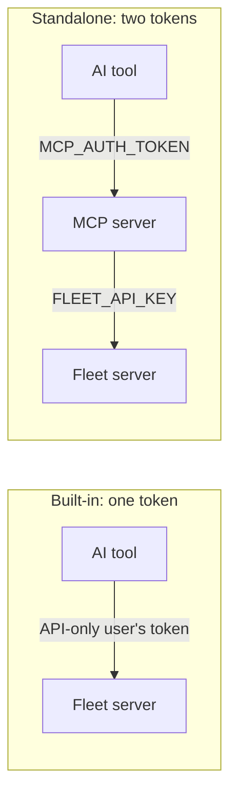

# Fleet MCP server

Fleet's [Model Context Protocol (MCP)](https://modelcontextprotocol.io/) server lets AI tools like Claude Code, Claude Desktop, and Cursor interact directly with your Fleet instance: looking up hosts, running live reports, checking policies, and investigating CVEs.

In Fleet Premium, the MCP server is built into the Fleet server, so there's nothing extra to deploy. You can also run it as a standalone service. This guide sets up the built-in MCP server.

## Built-in vs. standalone

| | Built-in | Standalone |
|:---|:---|:---|
| Available in | Fleet Premium | Fleet Free and Fleet Premium |
| Runs | Inside the Fleet server | As a separate service you deploy |
| AI tool connects to | `https://fleet.example.com/api/v1/fleet/mcp` | The standalone service's `/mcp` URL |
| Tokens | One: the API-only user's API token | Two: `MCP_AUTH_TOKEN` (AI tool to MCP server) and `FLEET_API_KEY` (MCP server to Fleet) |
| Transports | Streamable HTTP | Streamable HTTP, SSE, and stdio |
| Live reports wait up to | The Fleet server's `FLEET_LIVE_QUERY_REST_PERIOD` | The standalone service's `FLEET_LIVE_QUERY_REST_PERIOD` |
| Setup | This guide | [Fleet MCP README](https://github.com/fleetdm/fleet/tree/main/cmd/fleet-mcp) |



In both cases, the MCP server calls Fleet's API as an API-only user. Fleet checks that user's role, fleets, and API endpoints on every call.

## Prerequisites

- Fleet Premium v4.95.0 or later.
- An admin's API token, to create the API-only user. In the Fleet UI, select your avatar, then **My account > Get API token**.
- An MCP client that supports Streamable HTTP and lets you set an `Authorization` header, like Claude Code.

## Create an API-only user

Your AI tool acts as this user. Pick its role:

- **Observer+**: the least privileged role that can run live reports.
- **Observer**: read-only. Fleet refuses live reports.

To limit the AI tool to specific fleets, assign fleet-level roles (`fleets`) instead of `global_role`. See [Create API-only user](https://fleetdm.com/docs/rest-api/rest-api#create-api-only-user).

Create the user with the endpoints every tool needs. Replace `https://fleet.example.com` with your Fleet URL and set `FLEET_ADMIN_TOKEN` to an admin's API token:

```bash
curl -X POST https://fleet.example.com/api/v1/fleet/users/api_only \
  -H "Authorization: Bearer $FLEET_ADMIN_TOKEN" \
  -H "Content-Type: application/json" \
  -d '{
    "name": "Fleet MCP",
    "global_role": "observer_plus",
    "api_endpoints": [
      {"method": "POST", "path": "/api/v1/fleet/mcp"},
      {"method": "GET", "path": "/api/v1/fleet/fleets"},
      {"method": "GET", "path": "/api/v1/fleet/fleets/:fleet_id/policies/:policy_id"},
      {"method": "GET", "path": "/api/v1/fleet/fleets/:id/policies"},
      {"method": "GET", "path": "/api/v1/fleet/global/policies"},
      {"method": "GET", "path": "/api/v1/fleet/global/policies/:id"},
      {"method": "GET", "path": "/api/v1/fleet/host_summary"},
      {"method": "GET", "path": "/api/v1/fleet/hosts"},
      {"method": "GET", "path": "/api/v1/fleet/hosts/:id"},
      {"method": "POST", "path": "/api/v1/fleet/hosts/:id/query"},
      {"method": "GET", "path": "/api/v1/fleet/hosts/:id/software"},
      {"method": "GET", "path": "/api/v1/fleet/hosts/count"},
      {"method": "GET", "path": "/api/v1/fleet/hosts/identifier/:identifier"},
      {"method": "GET", "path": "/api/v1/fleet/labels"},
      {"method": "GET", "path": "/api/v1/fleet/labels/:id/hosts"},
      {"method": "GET", "path": "/api/v1/fleet/reports"},
      {"method": "POST", "path": "/api/v1/fleet/reports/run"},
      {"method": "GET", "path": "/api/v1/fleet/software/titles"},
      {"method": "GET", "path": "/api/v1/fleet/software/titles/:id"}
    ]
  }'
```

The `token` in the response is the API-only user's API token. Your AI tool uses it to connect.

For the standalone MCP server, replace `{"method": "POST", "path": "/api/v1/fleet/mcp"}` with `{"method": "GET", "path": "/api/v1/fleet/me"}` (**Get current user**). The standalone server checks the user at startup, and the token goes in its `FLEET_API_KEY`.

You can also create the user in the Fleet UI. Go to **Settings > Users**, select **Add user > API-only user**, and choose **Specific API endpoints**. The endpoint names in the next section match the names in that list.

> **Note:** If you limit the user to specific endpoints, always include **Use Fleet's MCP server** (`POST /api/v1/fleet/mcp`). Without it, Fleet refuses the connection with a `403`. If you leave out `api_endpoints`, the user can call every endpoint its role allows.

### Limit the AI tool to specific tools

Your AI tool only sees the tools whose endpoints the user is allowed to call. To allow fewer tools, leave out the endpoints they need. Calling a hidden tool returns an error that names the missing endpoints.

| Tool | What it does | API endpoints |
|:---|:---|:---|
| `get_aggregate_platforms` | Counts hosts by platform | Get hosts summary |
| `get_endpoints` | Lists hosts, with filters | List fleets, List hosts, Count hosts, Get host, List labels, List label's hosts |
| `get_fleets` | Lists fleets | List fleets |
| `get_host` | Gets a host's details | List hosts, Get host, Get host by identifier |
| `get_host_policies` | Gets a host's policy results | List hosts, Get host, Get host by identifier |
| `get_host_users` | Lists a host's local user accounts | List hosts, Get host, Get host by identifier |
| `get_labels` | Lists labels | List labels |
| `get_osquery_schema` | Gets osquery table schemas | None |
| `get_policies` | Lists policies with pass and fail counts | List fleets, List fleet-level policies, List policies (`GET /api/v1/fleet/global/policies`) |
| `get_policy_compliance` | Gets a policy's pass and fail counts | List fleets, Get fleet-level policy, Get policy |
| `get_policy_hosts` | Lists the hosts that pass or fail a policy | List fleets, List hosts, List labels, List label's hosts |
| `get_queries` | Lists reports | List fleets, List reports |
| `get_software` | Lists software inventory | List fleets, List hosts, Get host, List host's software, Get host by identifier, List software titles |
| `get_total_system_count` | Counts hosts | Count hosts |
| `get_vetted_queries` | Gets vetted CIS policy queries | None |
| `get_vulnerability_hosts` | Lists the hosts affected by a CVE | List fleets, List hosts, List software titles, Get software title |
| `get_vulnerability_impact` | Counts the hosts affected by a CVE | List hosts, Count hosts, List software titles, Get software title |
| `prepare_live_query` | Checks targets and gets the schema before a live report | List fleets, List hosts, Get host, Get host by identifier, List labels, List label's hosts, List software titles, Get software title |
| `run_live_query` | Runs a live report | List fleets, List hosts, Get host, Get host by identifier, List labels, List label's hosts, List software titles, Get software title, Run live query on host (ad hoc), Run live report (async) |

Live report results stream over a WebSocket, which isn't subject to endpoint restrictions, so there's nothing else to allow.

## Connect your AI tool

For Claude Code, replace the URL and token, then run:

```bash
claude mcp add --transport http fleet https://fleet.example.com/api/v1/fleet/mcp \
  --header "Authorization: Bearer <API-only user's token>"
```

For other clients, add a Streamable HTTP server with the same URL and an `Authorization: Bearer <API-only user's token>` header.

> **Note:** Live reports wait up to the Fleet server's `FLEET_LIVE_QUERY_REST_PERIOD` (default 25 seconds) for hosts to respond. If your AI tool stops waiting sooner, raise its tool timeout. In Claude Code, set `MCP_TOOL_TIMEOUT` in milliseconds.

> **Note:** Browser-based clients hosted on another site can't connect. Fleet refuses requests whose `Origin` header doesn't match Fleet's server URL.

## Verify

1. In Claude Code, run `/mcp`. **fleet** shows as connected.
2. Ask "How many hosts do we have?" The answer matches the host count in Fleet.

To check from a terminal instead, list the tools the user can call:

```bash
curl -X POST https://fleet.example.com/api/v1/fleet/mcp \
  -H "Authorization: Bearer $MCP_USER_TOKEN" \
  -H "Content-Type: application/json" \
  -d '{"jsonrpc": "2.0", "id": 1, "method": "tools/list"}'
```

## Turn off the MCP server

The built-in MCP server is on by default in Fleet Premium. To turn it off, use any of these:

- In the Fleet UI, go to **Settings > Organization settings > Advanced options**, clear **MCP server**, and select **Save**.
- With GitOps, set [`server_settings.mcp_disabled`](https://fleetdm.com/docs/configuration/yaml-files#server-settings) to `true` in `org_settings`.
- With the API, set `server_settings.mcp_disabled` to `true` with [Modify configuration](https://fleetdm.com/docs/rest-api/rest-api#modify-configuration).

While it's off, Fleet answers MCP requests with a `400` error: "Fleet's MCP server is disabled".

## Move from the standalone MCP server

1. Reuse the API-only user from `FLEET_API_KEY`. If it's limited to specific endpoints, add **Use Fleet's MCP server**. You can remove **Get current user**, since only the standalone server needs it.
2. In your AI tool, change the URL to `https://fleet.example.com/api/v1/fleet/mcp`.
3. Change the token from `MCP_AUTH_TOKEN` to the API-only user's token (the value of `FLEET_API_KEY`).
4. If your AI tool used SSE or stdio, switch it to Streamable HTTP.
5. Shut down the standalone service and delete its `MCP_AUTH_TOKEN`.

## Security

- Only API-only users can connect.
- Every tool call runs as the API-only user. Fleet applies the user's role, fleets, and API endpoints, and records activities, like live reports, under that user.
- Everyone who uses the token shares that identity, so Fleet can't tell who asked. To keep that record, log requests in your AI tool or bot.
- Live reports can run any osquery SQL on hosts. Tables like `curl`, `curl_certificate`, and `carves` can make network requests from hosts or collect files from them. To block these tables everywhere, including the Fleet UI and `fleetctl`, set `disable_tables` in [`command_line_flags`](https://fleetdm.com/docs/configuration/agent-configuration#options-and-command-line-flags). To keep your AI tool from running live reports at all, use the Observer role.

## Troubleshoot

**`401` error**

The token is missing or invalid. Check that the `Authorization` header is `Bearer` followed by the API-only user's token.

**`403` error: "Permission Denied"**

The token belongs to a regular user, or the client sent an `Origin` header that doesn't match Fleet's server URL. Use an API-only user's token and a client that doesn't run in a browser.

**`403` error: "endpoint not permitted for this API-only user"**

Add **Use Fleet's MCP server** to the user's API endpoints.

**`402` error**

The built-in MCP server needs Fleet Premium. On Fleet Free, use the standalone MCP server.

**`400` error: "Fleet's MCP server is disabled"**

An admin turned off the MCP server. Turn it back on in **Settings > Organization settings > Advanced options**.

**A tool is missing, or it says the user "isn't allowed to call" some endpoints**

Add the endpoints the tool needs to the user's API endpoints. The error message and the table in [Limit the AI tool to specific tools](https://fleetdm.com/guides/fleet-mcp#limit-the-ai-tool-to-specific-tools) list them.

**Live reports time out in the AI tool**

Raise your AI tool's tool timeout above the Fleet server's `FLEET_LIVE_QUERY_REST_PERIOD`.

## Further reading

- [Fleet MCP README](https://github.com/fleetdm/fleet/tree/main/cmd/fleet-mcp), to run the standalone MCP server
- [Use Fleet's MCP server](https://fleetdm.com/docs/rest-api/rest-api#use-fleets-mcp-server) in the REST API reference
- [Create API-only user](https://fleetdm.com/docs/rest-api/rest-api#create-api-only-user)

<meta name="articleTitle" value="Fleet MCP server">
<meta name="authorFullName" value="Noah Talerman">
<meta name="authorGitHubUsername" value="noahtalerman">
<meta name="category" value="guides">
<meta name="publishedOn" value="2026-04-29">
<meta name="description" value="Connect AI tools like Claude and Cursor to your Fleet instance using the Fleet MCP server.">
