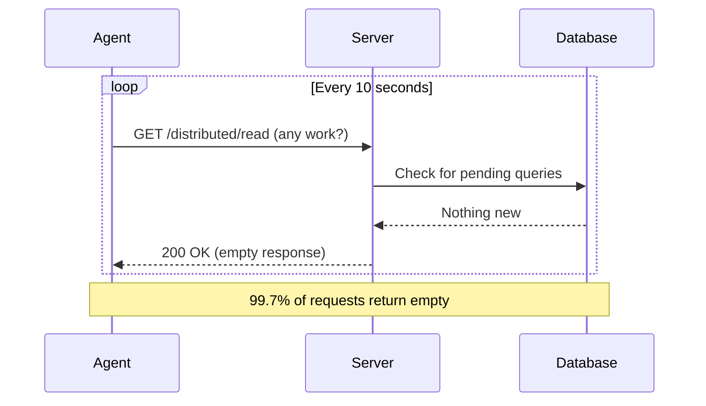
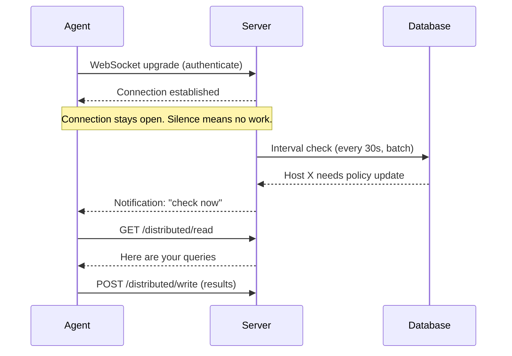
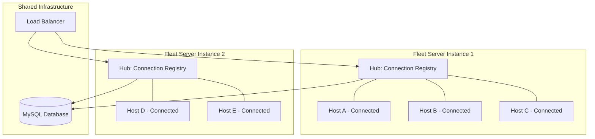
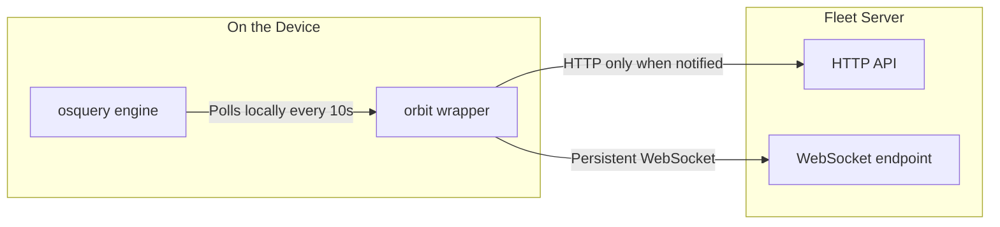

# How Fleet eliminated 99.7% of infrastructure polling with WebSockets

## Executive summary

Every device management platform in production today uses the same architecture: agents poll the server on a fixed interval asking for work, and the server almost always responds with nothing. At scale, this creates extraordinary waste. Fleet measured it: **99.7% of all polling requests return empty responses**.

Fleet replaced this polling model with persistent WebSocket connections, pushing notifications to agents only when there is actual work to do. The migration deployed across **170+ managed cloud customer instances in three rounds over two weeks**, with zero downtime and zero customer-reported issues. The result: billions of unnecessary daily requests eliminated, infrastructure costs reduced by more than half, and a real-time communication layer that makes every future feature faster and cheaper to operate.

This paper explains why the rest of the industry cannot easily follow, what Fleet built, and what the numbers look like.

## The problem: polling at scale

### How polling works

In a polling architecture, every enrolled device (called a "host") contacts the server on a regular interval to ask a simple question: "Do you have any work for me?" The server checks, almost always says "no," and the host waits and asks again.

Fleet's default polling interval is **10 seconds**. For a deployment with 50,000 hosts, this means:

| Metric | Value |
|--------|-------|
| Polls per host per day | 8,640 |
| Total polls per day (50K hosts) | **432 million** |
| Including config + other checks | **~1.2 billion requests/day** |
| Percentage returning empty | **99.7%** |

Think of it this way: imagine a company with 50,000 employees, and every single one of them calls their manager every 10 seconds to ask "any new tasks?" The manager says "nope" 997 times out of 1,000. The phone bill would be astronomical, and almost every call would be a complete waste. That is exactly what happens at the infrastructure level with polling.

### The real cost

Fleet's AWS bill for managed cloud infrastructure reached **$195,000 per month**. Running 50,000 hosts cost **$122 per day in data transfer alone**, not counting compute, load balancing, or database resources.

Every empty response still consumes:
- **Network bandwidth** for the HTTP request and response headers
- **Load balancer capacity** to route and terminate the TLS connection
- **Server CPU** to authenticate the request, query the database, and serialize the response
- **Database connections** to check whether any work is pending

Multiply those costs by 1.2 billion daily requests and you begin to see the problem.

### The industry default

This is not a Fleet-specific issue. **Every MDM and EDR vendor uses polling.** It is the known cost of doing business for device management at scale. CrowdStrike, Microsoft Intune, Tanium, Jamf, and every other major platform polls its agents on a fixed interval. The architecture is simple, proven, and expensive. Until now, nobody had a practical alternative in production.

## Why large platforms are stuck

If polling is so wasteful, why hasn't every vendor switched to WebSockets already? The answer is architectural, and it explains why Fleet's position as an open-source startup was actually an advantage.

### Polling is stateless (and that is why everyone uses it)

In a polling model, every request is independent. The server does not need to remember who is connected or maintain any persistent state. When a host sends a request, the server processes it and forgets about it. This is the same pattern that powers every website on the internet.

Scaling a stateless system is straightforward: put more servers behind a load balancer and distribute requests evenly. No single server needs to know about any other server. If one crashes, the next request simply goes to a different server. Operations teams have decades of tooling, monitoring, and playbooks built around this model.

### WebSockets are stateful (and that changes everything)

A WebSocket connection is persistent. The server and the agent maintain an open TCP connection for the entire session. The server must track every connected agent in memory: which host is connected to which server, whether the connection is healthy, and how to reach that specific host when work arrives.

At 10 million agents (a scale that CrowdStrike and Intune operate at), this means:

| Resource | Requirement |
|----------|-------------|
| Open TCP connections | 10,000,000 |
| Memory per connection | ~10-50 KB |
| Total connection memory | 100-500 GB |
| File descriptors | 10,000,000+ |
| Load balancer targets | 100+ instances (ALBs cap at ~100K connections per target) |

This is not just a matter of "more servers." The entire infrastructure model changes:

- **Sticky sessions**: Once a host connects to a specific server, messages for that host must route to that server. Standard round-robin load balancing no longer works.
- **Graceful restarts**: When you deploy a new version and restart a server, every host connected to that server loses its connection. At scale, this means millions of agents reconnecting simultaneously (the "thundering herd" problem), which can overwhelm the infrastructure.
- **Connection tracking**: The system needs a way to know which hosts are connected to which servers, so it can route notifications correctly. This typically requires a shared coordination layer (Redis, a message bus, or a consensus protocol).

### Legacy architecture compounds the problem

Large platforms like CrowdStrike and Intune were built around stateless request/response patterns over 10+ years. Refactoring the transport layer is not a simple swap. It means touching every component simultaneously:

- **The agent** needs to establish and maintain a persistent connection, handle reconnection, and fall back gracefully
- **The server** needs connection management, a notification dispatch system, and health monitoring for millions of open connections
- **The load balancer** configuration changes from stateless routing to sticky, connection-aware routing
- **The deployment pipeline** must handle rolling restarts without disconnecting millions of agents at once
- **The monitoring stack** needs entirely new metrics (connection count, connection duration, reconnection rate) instead of just request rate and latency

For a platform managing 10 million+ endpoints for Fortune 500 companies, this is a multi-year, high-risk project. The blast radius of a transport layer migration going wrong is enormous: every managed endpoint could lose connectivity simultaneously.

### Fleet's structural advantage

Fleet had three things that large vendors do not:

1. **Clean architecture**: Fleet's codebase is less than 10 years old, open-source, and designed with clear separation between the transport layer and business logic. Changing how agents communicate did not require rewriting how work gets processed.

2. **Hub-per-instance model**: Instead of a global connection registry, each Fleet server instance maintains its own Hub (a local registry of connected agents). This avoids the need for a distributed coordination layer and keeps the architecture simple.

3. **Incremental deployment with automatic fallback**: If a WebSocket connection fails for any reason, the agent automatically falls back to polling. This meant Fleet could deploy to 170+ instances without risking a single customer's connectivity. The worst case was always "it works exactly like it did before."

## What Fleet built

### Before: the polling model

In the original architecture, every agent contacted the server on a fixed interval, regardless of whether there was anything to do.

Every one of those arrows represents real infrastructure cost: TLS termination, authentication, database queries, serialized responses, and bytes on the wire. Multiply by 50,000 hosts and 8,640 polls per host per day.

### After: WebSocket push notifications

In the new architecture, the agent establishes a single persistent connection. The server only sends a message when there is actual work to do. Silence means "nothing new."

The critical difference: in the polling model, the agent initiates communication 8,640 times per day regardless of need. In the WebSocket model, the server initiates communication only when there is work, which happens a handful of times per day for a typical host.

### Architecture: the Hub model

Each Fleet server instance maintains its own **Hub**, a local registry of all WebSocket connections to that instance.

When work arrives for a host (a new query to run, a policy update, an MDM command), the server checks its local Hub. If the host is connected to this instance, it sends the notification immediately. If not, the host will pick up the work on its next check, which happens at a relaxed interval rather than every 10 seconds.

Key design decisions:

- **Authentication before upgrade**: The agent authenticates using its existing enrollment token before the WebSocket connection is established. Invalid or expired credentials never consume a WebSocket slot. This prevents resource exhaustion from unauthenticated connections.
- **Graceful fallback**: If the WebSocket connection drops (network change, server restart, timeout), the agent automatically reverts to standard polling. No manual intervention required, no lost commands.
- **Jittered reconnection**: When agents reconnect after a disconnection, each one waits a random interval (0 to 30 seconds) with exponential backoff. This prevents the thundering herd problem where thousands of agents simultaneously hammer the server after a restart.

### How osquery fits in

Fleet uses [osquery](https://osquery.io/), Facebook's open-source endpoint agent, as the query engine on each device. Understanding how osquery integrates with WebSockets requires knowing a key detail: Fleet does not modify osquery itself. Instead, Fleet ships **orbit**, a lightweight wrapper that sits between osquery and the Fleet server.

Previously, osquery polled the Fleet server directly every 10 seconds over HTTP. Now the communication flow has an intermediary:

Think of it as a receptionist model:
- **Before**: Every employee (osquery) called headquarters (Fleet server) every 10 seconds to ask for tasks. The phone lines were constantly busy.
- **After**: Every employee asks the local receptionist (orbit) every 10 seconds. The receptionist has an open phone line (WebSocket) to headquarters. Headquarters only calls when there is something to deliver. The employee gets their tasks just as fast, but the long-distance phone bill drops to nearly zero.

osquery continues to poll locally at its normal interval, so the query engine behavior is completely unchanged. The only difference is that the network traffic between the device and the server drops from constant polling to on-demand communication.

## Results

### Load test results (50,000 simulated hosts)

Fleet ran load tests simulating 50,000 hosts to measure the impact of WebSocket notifications before deploying to production.

| Metric | Polling (before) | WebSocket (after) | Reduction |
|--------|:-----------------:|:------------------:|:---------:|
| Daily idle requests | ~1.2 billion | Near zero | **~99.7%** |
| Data transfer cost per day | $122 | $52 | **57%** |
| Idle network traffic | Constant | Effectively zero | **~100%** |

The 57% data transfer reduction came from WebSocket alone, before the complementary ETag optimization described below.

### ETag optimization (complementary to WebSocket)

Alongside the WebSocket migration, Fleet implemented ETag-based caching for configuration responses. When an agent requests its configuration, the server includes a fingerprint (ETag) of the response. On subsequent requests, the agent sends the fingerprint back. If the configuration has not changed, the server responds with a tiny "not modified" message instead of the full configuration payload.

| Metric | Improvement |
|--------|:-----------:|
| Config response bandwidth | **95% reduction** (94.7-95.2% measured) |
| Database load for config checks | **87% reduction** |
| Network traffic reduction | **508 GB per hour** saved |
| Redis overhead | One small node at ~65% CPU absorbed the caching load |

WebSocket and ETag work together: WebSocket eliminates unnecessary requests entirely, and ETag shrinks the responses that do occur.

### Managed cloud deployment

Fleet deployed the WebSocket migration across its entire managed cloud fleet in three rounds over two weeks:

| Round | Date | Instances | Size | Issues |
|-------|------|:---------:|------|:------:|
| Round 1 | October 1 | 144 | Small | Zero |
| Round 2 | October 8 | 14 | Medium | Zero |
| Round 3 | October 15 | 12 | Large | Zero |
| **Total** | **2 weeks** | **170+** | **All sizes** | **Zero** |

The incremental rollout strategy (smallest instances first, largest last) meant that any issues would surface on lower-impact instances before reaching the largest customer deployments. The automatic fallback to polling provided an additional safety net. In practice, neither was needed: the deployment was uneventful across all 170+ instances.

### Projected savings

| Category | Estimate |
|----------|----------|
| Conservative monthly AWS reduction | **$10,000+** across all spend categories |
| Elastic load balancing | Targeting **50%+ reduction** from ~$1,300/day baseline |
| Full savings timeline | Expected once osquery 5.24 (with ETag support) ships to all customers |

`[TO BE FILLED: Actual measured savings after full rollout]`

`[TO BE FILLED: Before/after comparison of dogfood instance costs]`

### Internal (dogfood) baseline

Fleet's internal instance, running approximately 85 hosts, served as the canary deployment:

| Metric | Value |
|--------|-------|
| Pre-WebSocket daily cost | $105/day ($3,150/month) |
| Post-WebSocket daily cost | `[TO BE FILLED: measured after osquery/config coverage]` |

## Conclusion

Fleet proved that a startup with the right architecture can outmaneuver platforms 100x its size on infrastructure efficiency. The companies managing tens of millions of endpoints are architecturally locked into polling, not because they lack the engineering talent to build something better, but because the risk and complexity of migrating a stateful transport layer at that scale is prohibitive. Fleet did not have that constraint.

The WebSocket migration is not just a cost optimization. It is a **fundamental architectural advantage that compounds over time**. Every future feature that needs real-time communication (live queries, instant policy updates, immediate MDM command delivery) benefits from the persistent connection layer that is already in place. What previously required a polling cycle now happens in milliseconds.

Three properties made this possible:

1. **Open-source transparency**: Customers and the community can inspect the implementation, verify the security model, and contribute improvements. There is no black box.
2. **Graceful degradation**: The automatic fallback to polling meant the migration was zero-risk for every customer. The worst case was always "it works exactly like before."
3. **Incremental deployment**: Rolling out to 170+ instances in size order, over two weeks, with continuous monitoring, turned a potentially high-risk infrastructure change into a routine deployment.

This is phase 1. Configuration-level ETag coverage and the rollout of osquery 5.24 will multiply the savings further as every enrolled device benefits from both optimizations simultaneously.

`[TO BE FILLED: Final savings numbers and customer testimonials]`
