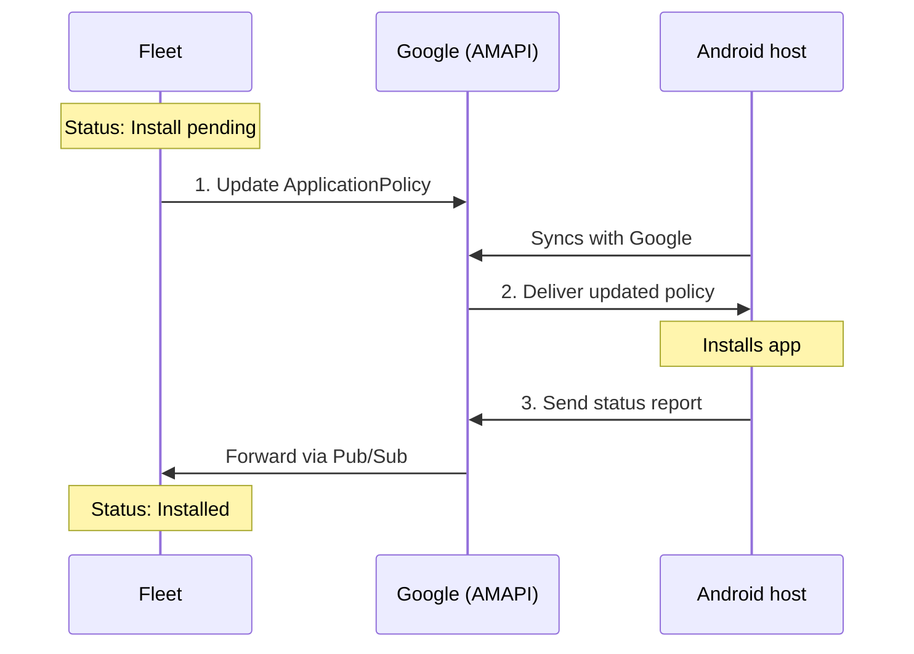

# How to manually sync an Android device

For testing, if you have physical access to the Android host, you can sync manually to speed things up:

1. Go to your Work Profile in **Settings**:
   1. Google devices: select your name at the top of **Settings**, then select your Work Profile.
   2. Samsung devices: select **Google**, then select your Work Profile.
2. Scroll to the bottom and select **Device Policy**.
3. Select the three dots in the upper right corner, then select **Sync policies**.
   - The message at the top of the screen should change to "Synced now".

On some devices, you may need to enable developer options first.

1. Go to **Settings > About phone**, and select **Build number** seven times.
   - A message will display during this period: "You are now _x_ steps away from being a developer."
2. Enter your PIN when prompted.
   - After successfully authenticating, a message will appear: "You are now a developer!"

To disable Developer options:

1. Go to **Settings**:
   - Google devices: select **System > Developer options**.
   - Samsung devices: select **Developer options** at the bottom of Settings, under About phone.
2. At the top, select the toggle to turn off Developer options.

# How Android hosts get changes from Fleet
Fleet doesn't communicate with Android hosts directly. Fleet and each host communicate through Google's Android Management API (AMAPI). Fleet delivers these changes by updating the host's policy in AMAPI:

- [Software deployment](https://fleetdm.com/guides/install-app-store-apps)
- [Configuration profiles](https://fleetdm.com/guides/custom-os-settings)
- [App configuration](https://fleetdm.com/guides/install-app-store-apps#managed-configuration)

Each change follows the same steps:

1. Fleet updates the host's policy in AMAPI. For example, when you install an app, Fleet adds it to the policy's application list.
2. The next time the host syncs with Google, Google delivers the updated policy and the host applies it. In this example, the host installs the app.
3. The host sends a status report to Google, and Google forwards it to Fleet. Fleet then updates the host's details, such as the app's status.

Fleet doesn't control when steps 2 and 3 happen. Sometimes changes don't appear immediately due to Google rate limiting, so a status like "Install pending" can stay in Fleet longer than you'd expect.

Host details, like the OS version and installed software, also come from these status reports. That's why there's no **Refetch** button for Android hosts.

Some changes don't use the host's policy, so manually syncing won't speed them up:

- Commands like **Lock**, **Wipe**, and **Clear passcode** are sent to the host as MDM commands instead of policy changes.
- Certificates are installed by the Fleet app on the host, which checks Fleet for new certificates every 15 minutes.

<meta name="articleTitle" value="How to manually sync an Android device">
<meta name="authorFullName" value="Steven Palmesano">
<meta name="authorGitHubUsername" value="spalmesano0">
<meta name="category" value="guides">
<meta name="publishedOn" value="2026-04-09">
<meta name="description" value="Learn how to manually sync an Android device.">
