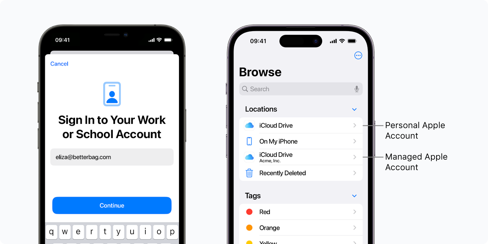
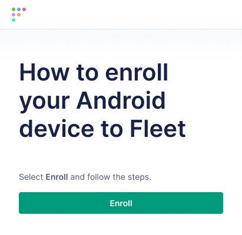

# MAM isn't a Microsoft thing anymore (but your LLM still thinks it is)

*An AI assistant tried to stop me from publishing this article. It was wrong, and so is the idea that protecting work data on personal phones means buying Microsoft.*

## Key takeaways

- **Google now protects work apps the way Microsoft does.** Since 2022, Gmail, Drive, Docs, and Google's other iOS apps have the same kind of data protection as Intune app protection, with no enrollment required.
- **BYOD enrollment has been low, but that's changing.** Historically, only about 31% of personal phones enroll in MDM. Easier enrollment, clear privacy, and conditional access are pushing that number up.
- **AI is a big reason why.** A publicly traded fintech company that resisted BYOD for years just started a program so tools like Claude can work on employees' devices and reach company data, with access gated by conditional access and an enrolled device.

## The MAM, the myth, the legend

When I asked an AI assistant to publish this article, it tried to stop me. It "fact-checked" my draft and quietly rewrote it before opening the pull request. It cut Chat and Meet from my list of Google apps, watered down the rest, and flagged my claims as unverified. I made it go read Google's current docs. It found I was right and put everything back. Then it insisted it hadn't tried to stop me.

That was the second time that day. Earlier, I'd spent an afternoon researching BYOD with an AI assistant, and every answer ended up in the same place. If you want to protect work data on personal phones without enrolling them in MDM, buy Microsoft: Intune app protection, Entra Conditional Access, Outlook. Everyone else is playing catch-up.

That used to be true. It isn't anymore.

> **What is MAM?** Mobile app management is just a way to keep work data inside work apps: it blocks copy-paste, saving, and sharing out of apps like Outlook or Gmail. Like any data loss prevention, it never fully works, because anyone can take a picture of the screen with another phone, or write down what they saw with a pencil. You can do roughly the same thing by enrolling the phone in your MDM.

Under the hood, it comes down to two controls. First, you decide which apps can sign in. Whoever issues the mail token gets to say which apps receive one. Microsoft uses Conditional Access to let Outlook in, and Google's Admin console does the same for Gmail. Either way, the built-in iPhone Mail app is out. Second, those apps keep work data in. They can block copy-paste into personal apps, the share sheet, AirDrop, saving to Files, and printing. Microsoft calls this Intune app protection. Google has the same switches in Gmail, Drive, Docs, Sheets, Slides, Chat, and Meet on iOS.

The assistant sounded very sure of itself, so I stopped asking who does MAM best and started asking how it works:

> "You sound like you've been reading propaganda. Show me why Microsoft does this best."
>
> "Isn't the same true for Gmail? Gmail becomes the only app that passes the sign-in check."

One by one, the Microsoft advantages fell apart. The assistant gave in once it read Google's admin docs.

## Nothing but the truth

You may have heard that app protection without enrollment only works with Intune. That's false, and it has nothing to do with managing devices. Outlook and the Office apps have some lightweight data controls built in, and Microsoft calls them MAM. Google has the same controls in Gmail and its other work apps, and so does any other office suite. There's no secret deal with Apple behind any of it.

Google lets you turn these controls on in the Google Workspace Admin console, alongside the rest of your Gmail and Drive settings, and you can push some of them through your device management tool, too. The only difference with Microsoft is that it makes you set them up in Intune, not in your email settings or the settings for your work apps. My guess is that Google simply doesn't have the leverage Microsoft has to force people onto its own tools, so it leans on open standards instead.

Thankfully, you can get around Microsoft's version by enrolling the phone in your MDM, like Fleet. Enrolling gives you complete control, because iOS itself can keep work data in work apps. One profile can stop files and copied text from moving between work apps and personal apps, for every app IT installs, Outlook included. Those are Apple's standard device management settings, an open standard any MDM can use. Once you're using them, you aren't tied to the limits of one company's office suite and its device management tool. For Microsoft, that's the point. It put these settings in Intune so you'd need both of its products, which makes the bundle harder to leave.

It's also worth asking how much this matters to you in practice. In my conversations with companies, most that have the license for MAM don't lean on it much. Some turned it on because it came in their Microsoft bundle, and some never turned it on at all.

So if you run Google Workspace and Okta, you aren't missing anything. Google decides which apps get in and keeps the data inside them. Okta handles sign-in and device checks with Okta Verify. You don't need Microsoft licenses to protect mail on personal phones, and you don't need to enroll those phones.

So why not enroll every phone? Because most people don't.

## Most people don't enroll

On paper, BYOD is everywhere. About 82% of organizations have a formal BYOD program, and Gartner says 55% of employees use a personal device for work at least some of the time.

In practice, it's mostly unmanaged. We looked at companies with 500 or more employees that give everyone a work computer. There, BYOD means phones, and most of those phones don't enroll. One industry estimate puts MDM enrollment at about 31% of personal devices, compared with about 78% of company-owned ones. Nobody publishes a clean number, so take that with a grain of salt.

It's not laziness. People don't know what IT can see on their personal phone, so they assume the worst. I don't blame them. I wouldn't enroll my phone in an MDM that isn't open source either, because I couldn't tell what it reads. My text messages? My browser history? What can it see? At a lot of companies, the answer is 🤷.

Skipping enrollment also makes for a rougher first day. A new hire without MDM adds their work account to the iPhone Mail app, and it fails without saying why. Someone tells them to download Gmail. They sign in, get bounced to Okta Verify for a device check, and come back. Later, they copy a line from an email into a personal note, and it pastes as a message saying it can only be shared within the company's apps.

With MDM, they open **Settings**, tap **Sign In to Work or School Account**, and log in with their work account. (Apple calls this [Account-driven User Enrollment](https://support.apple.com/guide/deployment/dep23db2037d/web).) Gmail or Outlook shows up already signed in, because IT set it up ahead of time. Work apps and data live in their own space on the phone, and IT can't see personal apps, photos, or messages. When the employee leaves, the work side goes away and the personal side stays.

Android is just as quick. The employee opens Fleet's enrollment page, taps **Enroll**, and Android sets up a work profile that keeps work apps separate from personal ones.

Those enrollment numbers aren't fixed. Enrolling a personal phone feels like a leap of faith. Make enrollment easy. Tell people plainly what IT can and can't see, and what they're giving up. More of them will say yes. For the rest, conditional access is the best way to require it: no enrollment, no work apps.

When enrollment is easy, more people enroll, IT gets fewer tickets, and new hires get to work faster. When people know what IT can see, BYOD can even be good for the culture. AI is speeding this up. One publicly traded fintech company held out against BYOD for years. It recently started a program because it wants tools like Claude to work on employees' devices and reach company data, with conditional access and an enrolled device deciding how much each one gets.

(Side note: this is why we're working on BYOD that puts employee privacy first at Fleet. Fleet is open source, so anyone can read exactly what it collects, and employees can ask an AI assistant what IT can see on their device. We call that scope transparency. We're also working on audit transparency, which makes it clear when data on a device is accessed while keeping the controls an organization needs.)

Moral of the story: when it comes to Microsoft, don't be afraid to check your LLM.

<meta name="category" value="articles">
<meta name="articleTitle" value="MAM isn't a Microsoft thing anymore (but your LLM still thinks it is)">
<meta name="authorFullName" value="Mike McNeil">
<meta name="authorGitHubUsername" value="mikermcneil">
<meta name="publishedOn" value="2026-11-20">
<meta name="description" value="Your AI assistant says BYOD app protection means Microsoft. Google Workspace has the same controls, with no Intune and no MDM required.">
