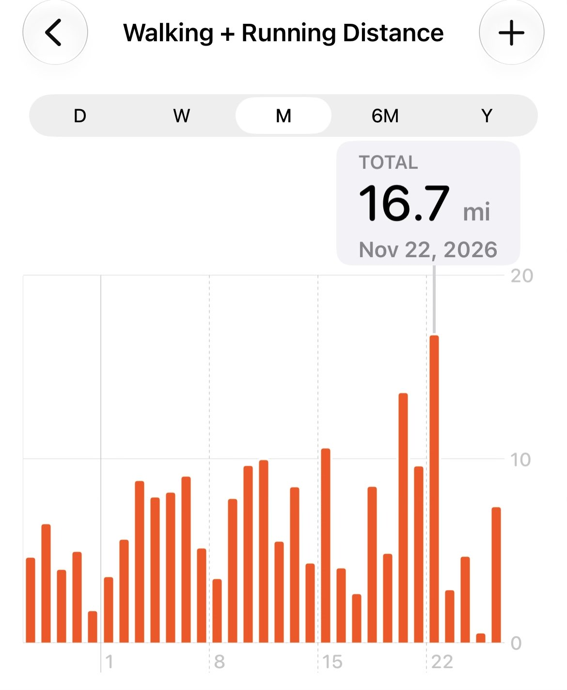

# Manage Dell PCs with Fleet

Firmware runs before Windows or Linux and before your EDR, so if there's a hole in it, every security tool you bought is sitting on top of that hole. That's why Dell ships its own tools for updating the BIOS, locking down its settings, and checking that nobody has tampered with it.

I took the question of what happens to all of that after Intune on a long walk with Claude, and the answer was simpler than I expected. Dell's Intune integrations come down to installing Dell's tools, running them with a script, and running them again when a device drifts. Nothing about that needs Intune. Fleet does the same thing with software, scripts, and policies, on Linux as well as Windows.



## Prerequisites

- Fleet Premium, for policy automations.
- Hosts enrolled with fleetd, with [scripts enabled](https://fleetdm.com/guides/scripts).
- If your Dell PCs have a BIOS admin password, a custom variable named `BIOS_PASSWORD`. Add it in **Controls** > **Variables** before you upload the scripts below, because Fleet won't save a script that uses a variable that doesn't exist yet.

> **Note:** Fleet doesn't yet store a unique BIOS password for each host ([#59972](https://github.com/fleetdm/fleet/issues/59972)), so for now one [custom variable](https://fleetdm.com/guides/secrets-in-scripts-and-configuration-profiles) holds the same password for every device. That keeps it out of your scripts and out of Git, which is the part that matters most. Fleet is already used in production on Dell hardware in healthcare, finance, and government, and this hasn't been a blocker there. If you'd like to talk through your setup, [reach out](https://fleetdm.com/support).

## Step 1: Label your Dell PCs

Navigate to **Hosts**, click **Filter by platform or label**, then **Add label**. Name it **Dell** and use this query:

```sql
SELECT 1 FROM system_info WHERE hardware_vendor LIKE 'Dell%';
```

Every policy and app below targets this label.

## Step 2: Install Dell Command | Update and Dell Command | Configure

[Dell Command | Update](https://www.dell.com/support/manuals/en-us/command-update/dcu_rg/dell-command-update-cli-commands?guid=guid-92619086-5f7c-4a05-bce2-0d560c15e8ed&lang=en-us) updates the BIOS, firmware, and drivers. It's a Fleet-maintained app, so navigate to **Software**, click **Add software**, and add **Dell Command Update** for Windows, targeting the **Dell** label.

Adding an app doesn't install it, so add a policy that fails when it's missing:

```sql
SELECT 1 FROM programs WHERE name LIKE 'Dell Command %Update' AND publisher = 'Dell Inc.';
```

Then, on the **Policies** page, click **Manage automations**, select **Install software**, check the policy, pick **Dell Command Update**, and click **Save**.

[Dell Command | Configure](https://www.dell.com/support/manuals/en-us/command-configure/dcc_5.x_ref_guide/) (`cctk`) changes BIOS settings. Download it from Dell and upload it as a custom package, targeting the **Dell** label.

## Step 3: Keep the BIOS, firmware, and drivers up to date

Navigate to **Controls** > **Scripts** and upload `dell-update-bios-firmware-drivers.ps1`:

```powershell
$dcu = "${env:ProgramFiles(x86)}\Dell\CommandUpdate\dcu-cli.exe"
if (-not (Test-Path $dcu)) { $dcu = "$env:ProgramFiles\Dell\CommandUpdate\dcu-cli.exe" }
if (-not (Test-Path $dcu)) { Write-Output 'Dell Command | Update not installed'; exit 1 }

& $dcu /applyUpdates -silent -reboot=disable -autoSuspendBitLocker=enable `
  -updateType=bios,firmware,driver -outputLog=C:\Windows\Temp\dcu-apply.log
$code = $LASTEXITCODE

# 0 = success, 1 = restart required, 5 = restart pending, 500 = no updates
if ($code -in 0, 1, 5, 500) { exit 0 }
exit $code
```

`-autoSuspendBitLocker=enable` suspends BitLocker for the next restart, so a BIOS update doesn't send the user to the recovery screen. To install only security and critical updates, add `-updateSeverity=security,critical`. Dell lists every exit code in the [CLI reference](https://www.dell.com/support/manuals/en-us/command-update/dcu_rg/command-line-interface-error-codes?guid=guid-fbb96b06-4603-423a-baec-cbf5963d8948&lang=en-us).

Next, add a policy that fails when a model's BIOS falls behind. Run this live report first to see what your hosts report:

```sql
SELECT s.hardware_model, p.version, p.date FROM system_info s, platform_info p;
```

Then add one policy per model, copying the model name and the minimum version from Dell's support page exactly as they appear:

```sql
SELECT 1 FROM system_info s, platform_info p
WHERE s.hardware_model != 'YOUR-MODEL'
   OR version_compare(p.version, 'X.Y.Z') >= 0;
```

Fleet doesn't track Dell's latest BIOS for each model, so this policy is only as current as the version you type in. Bump it when Dell ships a new one. Fleet is already used in production on Dell hardware in regulated industries, and this hasn't been a blocker there. If you'd like a hand, [reach out](https://fleetdm.com/support).

Finally, click **Manage automations** on the **Policies** page, select **Run script**, check the BIOS policies, pick the script, and click **Save**. Fleet runs the script when a host first fails the policy and retries it up to three times. Updates that need a restart finish when the user next restarts.

> **Note:** Fleet stops a script after 300 seconds by default, and BIOS downloads can take longer. Raise [`script_execution_timeout`](https://fleetdm.com/docs/configuration/agent-configuration#script-execution-timeout) in your agent options, for example to `1800`.

## Step 4: Lock down BIOS settings

Upload `dell-bios-security-settings.ps1`:

```powershell
$cctk = "${env:ProgramFiles(x86)}\Dell\Command Configure\X86_64\cctk.exe"
$pw = '$FLEET_SECRET_BIOS_PASSWORD'

& $cctk --SecureBoot=Enabled --TpmSecurity=Enabled --TpmActivation=Enabled `
  --Virtualization=Enabled --VtForDirectIo=Enabled --UefiNwStack=Disabled `
  --UefiBootPathSecurity=AlwaysExceptInternalHdd "--ValSetupPwd=$pw"
exit $LASTEXITCODE
```

Before the script reaches the device, Fleet swaps `$FLEET_SECRET_BIOS_PASSWORD` for the variable's value. If your PCs don't have a BIOS password, drop `$pw` and the `--ValSetupPwd` argument.

This turns on Secure Boot, the TPM, and virtualization, and turns off UEFI network (PXE) boot. Dell doesn't have a single switch for USB boot. Instead, `--UefiBootPathSecurity=AlwaysExceptInternalHdd` asks for the BIOS admin password before the PC boots from anything but its internal drive, so nobody can start it from a USB stick without that password. Dell's [security profile](https://www.dell.com/support/manuals/en-us/command-configure/dcc_5.x_ref_guide/security-profile?guid=guid-66ba0e99-ad94-42f0-a162-00a673fd138e) lists recommended values for the rest.

To check each setting, add a policy. On Dell PCs from 2018 on, [`wmi_bios_info`](https://fleetdm.com/tables/wmi_bios_info) reads BIOS settings by the same names `cctk` uses:

```sql
SELECT 1 FROM wmi_bios_info WHERE name = 'UefiNwStack' AND value = 'Disabled';
```

Older Dell PCs with Dell Command | Monitor report different names, so run `SELECT name, value FROM wmi_bios_info;` as a live report on one PC of each model first. Secure Boot and the TPM have their own tables:

```sql
SELECT 1 FROM secureboot WHERE secure_boot = 1;
```

```sql
SELECT 1 FROM tpm_info WHERE enabled = 1 AND activated = 1;
```

Turn on **Run script** for these policies with the settings script, the same way as in step 3. If someone changes a setting, the policy fails at the next check-in and Fleet puts it back. The BIOS password is what stops them from changing it in the first place, so use both.

## Step 5: Check Dell Trusted Device BIOS verification

[Dell Trusted Device](https://www.dell.com/support/kbdoc/en-us/000130811/how-to-run-bios-verification-using-dell-trusted-device) compares the BIOS on the PC with a known-good copy on Dell's servers. In Intune, Dell reports the result with a custom compliance script. Fleet policies can't read arbitrary WMI classes yet ([#59971](https://github.com/fleetdm/fleet/issues/59971)), so you'll get the result with a Fleet script instead. This hasn't been a blocker for teams running Fleet on Dell hardware in healthcare, finance, and government. If you have questions about your environment, [reach out](https://fleetdm.com/support).

For Dell Trusted Device 2.1 through 6.0, upload `dell-trusted-device-bios-verification.ps1`:

```powershell
$exe = "$env:ProgramFiles\Dell\TrustedDevice\Dell.SecurityCenter.Agent.Console.exe"
if (-not (Test-Path $exe)) { Write-Output 'Dell Trusted Device console not found'; exit 1 }

& $exe -headless
$code = $LASTEXITCODE
switch ($code) {
  0 { Write-Output 'BIOS verification passed' }
  1 { Write-Output 'BIOS verification failed' }
  2 { Write-Output 'Verification result was tampered with' }
  7 { Write-Output 'Dell verification server unavailable' }
  default { Write-Output "Return code $code" }
}
exit $code
```

Dell retired this console in 6.1. On newer versions, download the Trusted Device Agent Scripts from [Dell](https://www.dell.com/support/home/en-us/product-support/product/trusted-device/drivers) and upload `Get-TrustedDeviceResults.ps1`. It's the [same script Dell gives Intune customers](https://www.dell.com/support/kbdoc/en-us/000222830/capture-dell-trusted-device-telemetry-with-microsoft-intune), and the `TrustedDeviceComplianceRules.json` file that comes with it shows which results count as passing.

To check every Dell PC at once, navigate to **Hosts**, filter by the **Dell** label, select the hosts, click **Run script**, and run it now or on a schedule. A failed verification shows up as a failed script run in the host's activity.

## Step 6: Do the same on Linux

Dell Command | Update and Dell Trusted Device are Windows-only. On Linux:

- **Updates:** Dell [publishes BIOS updates](https://www.dell.com/support/kbdoc/en-us/000122025/how-to-update-firmware-under-linux) to the [Linux Vendor Firmware Service](https://fwupd.org/), and [fwupd](https://fwupd.github.io/libfwupdplugin/fwupdmgr.html) installs them.
- **Settings:** Dell Command | Configure has a [Linux version](https://www.dell.com/support/manuals/en-us/command-configure/dcc_5.x_ig/installing-dell-command-configure-on-linux-systems?guid=guid-9d3f8b53-abb4-4d54-9049-b1e0bfbfc100&lang=en-us) for RHEL 8 and 9 and Ubuntu 20.04, 22.04, and 24.04. Upload its package to Fleet like any other.

Upload `linux-update-firmware.sh`, add a Linux copy of the BIOS version policy from step 3, and attach the script to it:

```bash
#!/bin/bash
fwupdmgr refresh
fwupdmgr update --assume-yes --no-reboot-check
rc=$?

# 2 = nothing to do
if [ "$rc" -eq 2 ]; then exit 0; fi
exit "$rc"
```

`dell-bios-security-settings.sh` uses the same `cctk` options as the Windows script:

```bash
#!/bin/bash
pw='$FLEET_SECRET_BIOS_PASSWORD'
/opt/dell/dcc/cctk --SecureBoot=Enabled --TpmSecurity=Enabled --TpmActivation=Enabled \
  --Virtualization=Enabled --VtForDirectIo=Enabled --UefiNwStack=Disabled \
  --UefiBootPathSecurity=AlwaysExceptInternalHdd "--ValSetupPwd=$pw"
```

To check settings on Linux, read the kernel's [`dell-wmi-sysman`](https://kernel.org/doc/Documentation/ABI/testing/sysfs-class-firmware-attributes) driver with `file_lines`. The `secureboot` policy from step 4 works on Linux too.

```sql
SELECT 1 FROM file_lines
WHERE path = '/sys/class/firmware-attributes/dell-wmi-sysman/attributes/UefiNwStack/current_value'
  AND line = 'Disabled';
```

For a wider check of firmware protections, run `fwupdmgr security --json` as a script. It scores the PC from HSI:0 (insecure) to HSI:4 (secure) using fwupd's [Host Security ID](https://fwupd.github.io/libfwupdplugin/hsi.html).

## Treat a surprise BitLocker prompt as a signal

None of this replaces disk encryption, so [keep enforcing it](https://fleetdm.com/guides/enforce-disk-encryption). The two also back each other up: a BitLocker recovery prompt nobody expected can be the first sign that something in the boot chain changed. Before the help desk reads out a recovery key, have them look the host up in Fleet. Did Secure Boot turn off, did the BIOS verification fail, or was there a BIOS update? If nothing explains it, investigate before unlocking.

## Manage it with GitOps

`default.yml`:

```yaml
labels:
  - name: Dell
    query: SELECT 1 FROM system_info WHERE hardware_vendor LIKE 'Dell%';
    label_membership_type: dynamic
agent_options:
  script_execution_timeout: 1800
  # ...the rest of your existing agent options
```

Add these to the `labels` and `agent_options` you already have, since GitOps removes labels that aren't listed. Policy automations live in a fleet file, and each script must also be listed in that fleet's `controls.scripts`. `fleets/workstations.yml`:

```yaml
name: Workstations
controls:
  scripts:
    - path: ../lib/windows/scripts/dell-update-bios-firmware-drivers.ps1
    - path: ../lib/windows/scripts/dell-bios-security-settings.ps1
    - path: ../lib/linux/scripts/linux-update-firmware.sh
software:
  fleet_maintained_apps:
    - slug: dell-command-update/windows
      labels_include_any:
        - Dell
policies:
  - name: Dell - Dell Command | Update is installed
    platform: windows
    query: SELECT 1 FROM programs WHERE name LIKE 'Dell Command %Update' AND publisher = 'Dell Inc.';
    labels_include_any:
      - Dell
    install_software:
      fleet_maintained_app_slug: dell-command-update/windows
  - name: Dell - BIOS is up to date
    platform: windows
    query: SELECT 1 FROM system_info s, platform_info p WHERE s.hardware_model != 'YOUR-MODEL' OR version_compare(p.version, 'X.Y.Z') >= 0;
    labels_include_any:
      - Dell
    run_script:
      path: ../lib/windows/scripts/dell-update-bios-firmware-drivers.ps1
  - name: Dell - UEFI network boot is off
    platform: windows
    query: SELECT 1 FROM wmi_bios_info WHERE name = 'UefiNwStack' AND value = 'Disabled';
    labels_include_any:
      - Dell
    run_script:
      path: ../lib/windows/scripts/dell-bios-security-settings.ps1
  - name: Secure Boot is on
    platform: windows,linux
    query: SELECT 1 FROM secureboot WHERE secure_boot = 1;
```

Store the BIOS password as a GitHub or GitLab secret named `FLEET_SECRET_BIOS_PASSWORD`, as described in [Secrets in scripts and configuration profiles](https://fleetdm.com/guides/secrets-in-scripts-and-configuration-profiles).

## Further reading

If you're coming from Intune, these are the Dell integrations this guide replaces:

- [Dell Command | Update with Microsoft Intune](https://www.dell.com/support/manuals/en-us/command-update/admx_rg/using-microsoft-intune?guid=guid-8e1f9749-35cc-46cd-82cd-bc9576b32575&lang=en-us)
- [Dell Command | Endpoint Configure for Microsoft Intune](https://www.dell.com/support/kbdoc/en-us/000214308/dell-command-endpoint-configure-for-microsoft-intune)
- [Capture Dell Trusted Device telemetry with Microsoft Intune](https://www.dell.com/support/kbdoc/en-us/000222830/capture-dell-trusted-device-telemetry-with-microsoft-intune)

None of this needs Windows Autopilot or Entra. For new PCs, see [Windows zero touch without Entra or Autopilot](https://fleetdm.com/guides/windows-zero-touch-without-entra-or-autopilot), and if you're wondering what it costs to drop Microsoft 365 E3 altogether, we [priced it out](https://fleetdm.com/articles/leaving-e3-entirely). Managing HP or Lenovo too? See [Manage HP PCs with Fleet](https://fleetdm.com/guides/manage-hp-pcs-with-fleet) and [Manage Lenovo PCs with Fleet](https://fleetdm.com/guides/manage-lenovo-pcs-with-fleet).

If you're a Fleet customer, we can help you get this set up quickly as part of your Fast Track. Either way, if you run into any trouble, let us know. We're happy to help, and there's a friendly community of kind people who are happy to help too: [get support](https://fleetdm.com/support).

<meta name="articleTitle" value="Manage Dell PCs with Fleet">
<meta name="authorFullName" value="Mike McNeil">
<meta name="authorGitHubUsername" value="mikermcneil">
<meta name="category" value="guides">
<meta name="publishedOn" value="2026-11-27">
<meta name="description" value="Update the BIOS, lock down settings, and check Dell Trusted Device on Windows and Linux with Fleet, no Intune required.">
