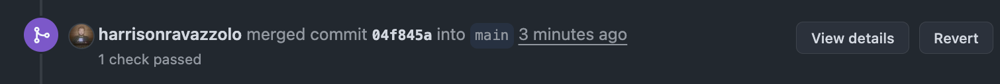
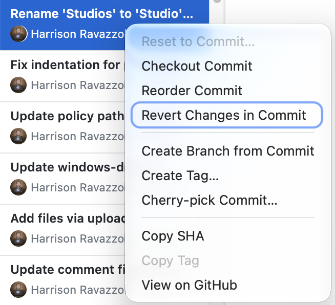

# How to Revert a Bad Config Change

## The golden rule: revert, don't rewrite 🔁

When a bad change lands on `main`, add a new commit that undoes it. Never delete the bad commit. That new commit is called a **revert**. It goes through `main` like any other change, the apply workflows runs again, and the previous settings come back into Fleet. 
TODO Harry - Add context on why? How this differentiates gitops vs clickops workflows?

Why a revert, not a reset and force-push:

- **It's safe for everyone.** History isn't rewritten, so nobody's local branch breaks.
- **It's auditable.** The log shows exactly what shipped, when it was rolled back, and by whom.
- **It follows our normal process.** Reverts use the same PR, review and apply pipeline as any other change.

| Situation | Fastest way to revert |
| --- | --- |
| Change came in through a merged PR | **Revert** button on the PR in GitHub (see below) |
| Change was pushed straight to `main` | GitHub Desktop or a terminal, then push |
| Production is on fire right now | Re-run the last good workflow, then revert properly |

## Standard path: reverting a merged PR

This is our normal process. Pick whichever tool you're comfortable with; all three end with a revert PR that gets merged into `main`.

### Option A: Directly on GitHub

1. Open the merged PR on github.com.
2. Scroll to the bottom and click **Revert** (next to "Pull request successfully merged and closed").
3. GitHub creates a `revert-<number>-<branch>` branch and opens a new PR with the inverse changes.
4. Add a short note on what went wrong, get it approved, and merge it.
5. Watch the Actions tab and confirm the apply workflow for the revert succeeds.



### Option B: GitHub Desktop

1. Switch to `main`, then **Fetch origin** and **Pull**.
2. Create a new branch, e.g. `revert-<what-broke>`.
3. Open the **History** tab, right-click the bad commit, and choose **Revert changes in commit**.
4. **Publish branch**, then **Create Pull Request**. Review, approve and merge as usual.



### Option C: VS Code (or integrated terminal)

VS Code's Source Control panel doesn't have a reliable "revert this commit" action, so use the terminal:

```bash
git checkout main && git pull
git checkout -b revert-<what-broke>
git log --oneline            # find the bad commit's SHA
git revert <sha>             # squash or rebase merge
git revert -m 1 <sha>        # regular "Merge pull request #..." commit
git push -u origin revert-<what-broke>
```

Then open the PR on GitHub and merge it.

**Which `git revert` do I use?** If the commit message starts with "Merge pull request #…", it's a merge commit and needs `-m 1` (keep the `main` side). Otherwise use plain `git revert <sha>`.

**Need it fast?** If branch protection requires approvals and it's urgent, ask an admin to bypass the rule for the revert PR. Don't skip the PR entirely.

## If you pushed straight to `main`

This is not best practice, but if it happens, the fix is the same: create a revert commit and push it to `main`. The difference is that others may have pushed after you, so **always pull first**.

### GitHub Desktop

1. On `main`, **Fetch origin** and **Pull**.
2. Open **History**, right-click the bad commit, and choose **Revert changes in commit**.
3. Click **Push origin**.

### VS Code (or integrated terminal)

```bash
git checkout main && git pull
git log --oneline            # find the bad commit's SHA
git revert <sha>             # save and close the message editor
git push
```

If the bad change spans several commits, revert the range: `git revert <oldest-bad-sha>^..<newest-bad-sha>`. You get one revert commit per bad commit.

### GitHub website

The website has no Revert button for a single commit pushed directly; the button only exists on PRs. Use Desktop or the terminal.

After pushing, check the Actions tab. If several people pushed close together, make sure the run for **your revert commit** is the one that finished last and succeeded.

## Emergency stopgap: re-run the last good apply

If you need the old settings back *right now*, before a revert PR can be reviewed:

1. Go to the repo's **Actions** tab.
2. Find the last successful apply run from **before** the bad change.
3. Click **Re-run all jobs**.

A re-run uses that run's original commit, so it reapplies the previous config. **This is temporary.** `main` still contains the bad change, and the next merge will apply it again. Always follow up with a proper revert.

## What a revert won't undo

A revert restores the YAML in the repo. It doesn't always restore the exact state of the system that YAML manages:

- **Deleted items come back as new items.** If the bad change removed a policy, script, profile or team setting, the revert recreates it. It may get a new ID and lose its history, such as policy pass/fail results.
- **Changes already on devices stay there.** A configuration profile that was delivered or a script that already ran isn't rolled back by the revert.
- **Anything changed outside the repo isn't tracked.** Manual changes made in the UI may be overwritten by the next apply.

After any revert, spot-check the affected settings and note any cleanup you had to do by hand in the revert PR.

**Don't** run `git reset --hard` followed by `git push --force` on `main`. It erases other people's commits, breaks everyone's local copy, and removes the audit trail.

<meta name="articleTitle" value="How to revert a bad config change in GitOps">
<meta name="authorFullName" value="Harrison Ravazzolo">
<meta name="authorGitHubUsername" value="harrisonravazzolo">
<meta name="category" value="guides">
<meta name="publishedOn" value="2026-10-18">
<meta name="description" value="Undo a bad GitOps change in Fleet with a revert commit instead of a reset and force-push.">
