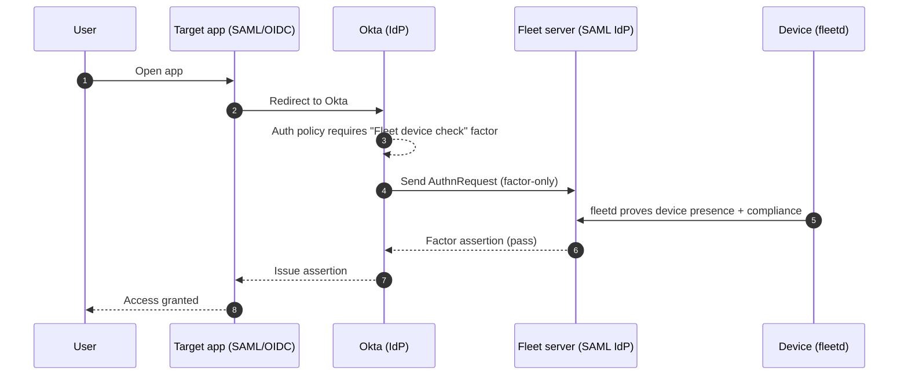
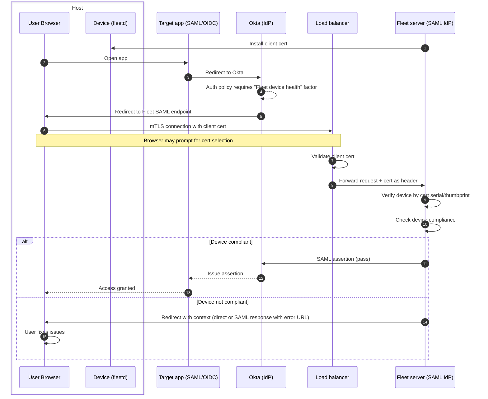
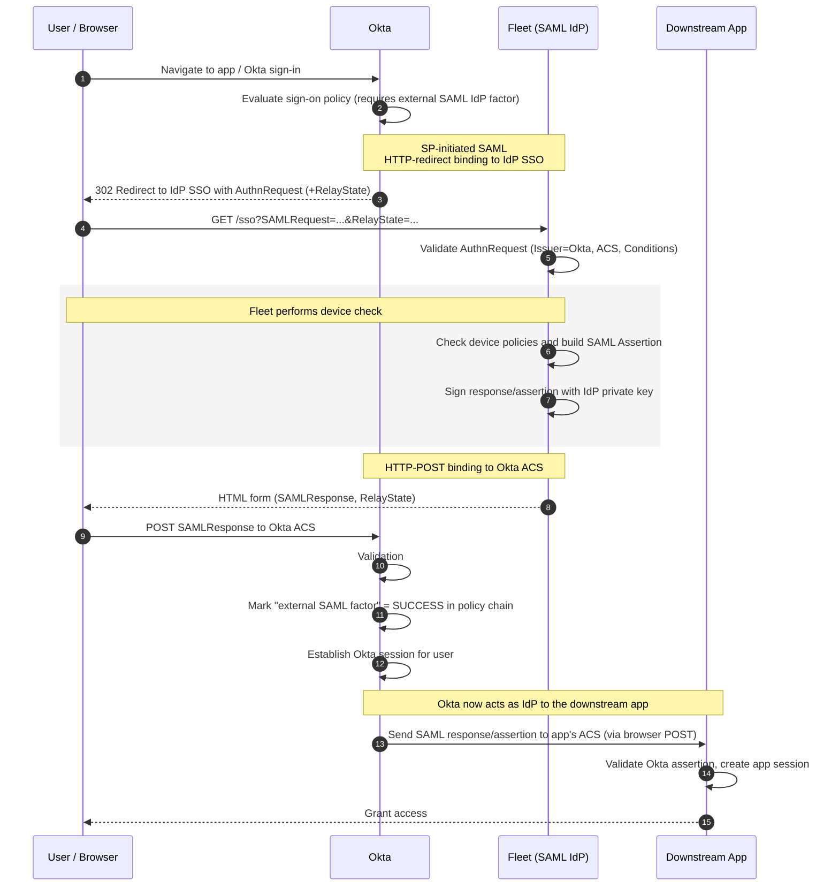
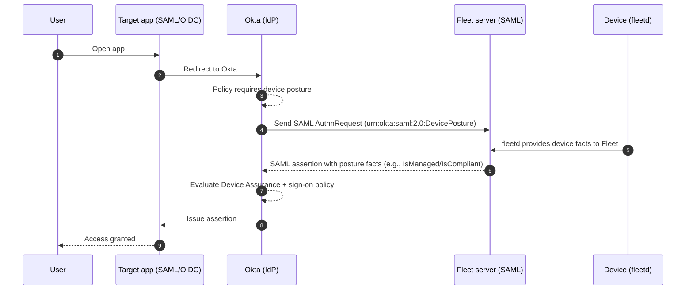

# Okta conditional access research

## Okta Verify

**What it is.** Okta Verify is Okta’s endpoint agent that enables FastPass (passwordless), device registration, and device posture collection for policy evaluation. Device assurance policies and posture checks are designed to work natively with Okta Verify and are evaluated at app sign-in.

**osquery support.** On macOS and Windows, Okta Verify bundles an osquery component to run **advanced posture checks** defined by admins (SQL-style checks that return pass/fail). This is conceptually similar to how fleetd leverages osquery, but here it’s packaged and invoked by Okta Verify for policy use.

**EDR integrations.** Okta Verify can ingest trust signals from supported EDR sources (for example, CrowdStrike and Windows Security Center) and expose them to policies via device assurance/custom expressions.

**Ecosystem support.** Other MDMs (e.g., Kandji, Jamf) document Okta Device Trust/Verify–based integrations as the standard way to gate access to Okta-protected apps.

**Recommendation.** If we want **Fleet** to control the device-gate experience or be the source of truth for posture, we should pursue a different path than using Okta Verify -- e.g., a **possession factor** (factor-only IdP) or Okta’s **Device Posture Provider** (EA) to feed Fleet’s signals into policies without relying on Okta Verify. ([Integrate Okta with Device Posture Provider](https://help.okta.com/oie/en-us/content/topics/identity-engine/devices/device-assurance-device-posture-idp.htm))

### How does Okta Verify talk to Okta during login?

* Okta Verify's FastPass first tries a localhost connection to the Okta Verify app
* If that can’t be used, the browser falls back to interactive deep links (custom URL scheme or app/universal links) to open Okta Verify.

---

## The key challenge: passing device information to web browser

Eventually, we want to support all major web browsers and mobile browsers on all major platforms.

Accessing device information using localhost is fragile:
- Chrome is restricting localhost access (Private Network Access)
- Safari blocks mixed content aggressively
- Firefox requires specific security headers
- Corporate proxies/firewalls may block localhost ports

We could use a browser extension to pass device information to the browser
- Requires a separate extension for each browser
- Does not work on mobile browsers
- Used by Kolide

We could use mTLS for our IdP endpoint
- Single implementation works across all browsers (Chrome, Safari, Firefox, Edge)
- No platform-specific code: same approach for Windows, macOS, Linux
- No browser extensions to develop and maintain
- No localhost battles with browser security policies
- Standard TLS: well-understood, battle-tested protocol
- We must manage certificates and renewal
- Infra becomes more complex
  - Proposal: load balancer terminates mTLS and passes the client cert as header
- Potential UX issues: users may need to picks a certificate from a list (this can be mitigated with a config profile)

## Using a possession factor instead of Okta Verify

**Overview.** Instead of relying on Okta Verify for device trust, we can make **Fleet** act as a **possession factor** (Okta IdP authenticator with *factor-only* usage). Okta will require this factor during login; Fleet validates the device (via **fleetd**) and returns pass/fail.

**How it works (happy path).**

**How it works with mTLS and load balancer (happy path).**

**Fleet requirements.**

* Expose a **factor-only SAML endpoint** that validates Okta’s AuthnRequest and returns a signed SAML response (pass/fail).
* On factor evaluation, query required device policies and return pass/fail.
* Provide a user-facing remediation URL when the factor denies.

**SAML flow with Okta using Fleet as IdP**

**Links.**

* [1Password Extended Access Management's Okta integration](https://blog.1password.com/extended-access-management-okta-guide)
* [Connect Kolide to Okta](https://www.kolide.com/docs/admins/setting-up-kolide/connect-kolide-to-okta)

### Client certificate delivery

Fleet's conditional access SCEP server (`/api/fleet/conditional_access/scep`) issues the client certificate. It accepts only global enroll secrets as the challenge. The certificate's SAN URI carries the host UUID, which the SCEP depot uses to link the certificate's serial to the host. The IdP then looks up the host by the serial that the mTLS proxy forwards in `X-Client-Cert-Serial`. Both platforms use `CN=Fleet conditional access for Okta`, which browsers filter on, and put `$FLEET_VAR_CERTIFICATE_RENEWAL_ID` in the OU so Fleet renews the certificate.

#### macOS

`GET /api/v1/fleet/conditional_access/idp/apple/profile` renders one `.mobileconfig` with user scope. It trusts Fleet's CA, enrolls the certificate over SCEP, sets an identity preference, and sets Chrome's `AutoSelectCertificateForUrls` for the mTLS URL. The SAN URI prefix is `urn:device:apple:uuid:`.

#### Windows

`GET /api/v1/fleet/conditional_access/idp/windows/profiles` returns two SyncML profiles as JSON (`scep_profile` and `browser_profile`).

**Why two profiles.** Fleet requires a Windows SCEP profile to contain only `ClientCertificateInstall/SCEP/` nodes and exactly one `Exec` on `Install/Enroll`. Windows enrolls asynchronously: the SCEP CSP answers the `Exec` with 200 as soon as it queues the enrollment and reports the result later through the `Status` and `ErrorCode` nodes. Fleet's tracking (verifying status, status probe, retries, renewal) assumes one profile is exactly one certificate, so the browser configuration can't ride along. The scopes also differ: the certificate is `./User`, the browser policies are `./Device`, and Fleet delivers a profile with any `./User` node only after a user signs in.

**SCEP profile.** Nodes live under `./User/Vendor/MSFT/ClientCertificateInstall/SCEP/$FLEET_VAR_SCEP_WINDOWS_CERTIFICATE_ID`, so the certificate lands in the signed-in user's `CurrentUser\My` store, where browsers look for client certificates. Fleet wraps the profile in `<Atomic>` so the node tree exists before the `Exec` runs.

| Node | Value |
|------|-------|
| `ServerURL` | `$FLEET_VAR_CONDITIONAL_ACCESS_SCEP_URL`, filled in at delivery as `<server_url>/api/fleet/conditional_access/scep`. The Windows SCEP client appends `/pkiclient.exe`, which the SCEP server also serves. |
| `Challenge` | A global enroll secret written in by the admin, directly or through a `$FLEET_SECRET_*` variable. The rendered profile carries an XML comment placeholder, which parses as an empty challenge, so upload rejects the profile until it's replaced. Windows encodes the challenge as a PrintableString, so upload also rejects characters outside letters, numbers, spaces, and `' ( ) + , - . / : = ?`. |
| `CAThumbprint` | Uppercase hex SHA-1 of Fleet's conditional access CA certificate. |
| `SubjectName` | `CN=Fleet conditional access for Okta,OU=$FLEET_VAR_CERTIFICATE_RENEWAL_ID` |
| `SubjectAlternativeNames` | `7+urn:device:fleet:uuid:$FLEET_VAR_HOST_UUID` (`7` is a URI). |
| `EKUMapping` | `1.3.6.1.5.5.7.3.2` (client authentication). |
| `KeyUsage`, `KeyLength`, `HashAlgorithm` | `160`, `2048`, `SHA-2`, matching the macOS payload. |
| `KeyProtection` | `2`: TPM when available, so the private key isn't exportable. |

The SAN prefix `urn:device:fleet:uuid:` is platform-neutral. The depot accepts it and the Apple prefix, which deployed macOS profiles keep using.

**Browser profile.** Windows MDM can't write a registry value directly, so the profile ingests a small Fleet-authored ADMX (`./Device/Vendor/MSFT/Policy/ConfigOperations/ADMXInstall/FleetConditionalAccess/Policy/FleetConditionalAccessAdmx`) and then sets its two policies through the Policy CSP. They write the `AutoSelectCertificateForUrls` rule (the same JSON as the macOS profile) to value `999` under `HKLM\Software\Policies\Google\Chrome\AutoSelectCertificateForUrls` and `HKLM\Software\Policies\Microsoft\Edge\AutoSelectCertificateForUrls`. Chromium reads every integer-named value under those keys, so `999` leaves an admin's own rules (`1`, `2`, ...) alone. A Group Policy that manages the same key takes precedence. Windows Home doesn't support ADMX ingestion and answers the `ADMXInstall` with 406, which is why the feature requires Windows 11 Pro, Enterprise, or Education. Firefox has no equivalent policy and prompts for the certificate.

**Fleet-tracked delivery.** `$FLEET_VAR_CONDITIONAL_ACCESS_SCEP_URL` marks the profile as conditional access, the same way NDES and custom SCEP variables mark theirs. At delivery, Fleet writes a `host_mdm_managed_certificates` row with type `conditional_access`. Because of that type:

- After the device acknowledges the profile, it moves to verifying, not verified.
- 30 seconds later, Fleet sends a status probe (a `Get` on the SCEP node's `Status` and `ErrorCode`) and repeats it up to 15 times until the host reports a result. `1` marks the profile verified. `16` marks it failed with the error code and retries.
- When osquery (5.23.1 or later) reports the certificate with OU `fleet-<profile_uuid>`, Fleet records its serial and validity on the row, as for NDES. The depot doesn't write these.
- The renewal job resends the profile about 30 days before the certificate expires. The `Add`s come back 418 and Fleet resends them as `Replace`, then the `Exec` enrolls a new certificate. Chromium prefers the newest valid certificate, so no cleanup is needed.

---

## Using a device posture provider instead of Okta Verify (Early Access)

**Overview.** Instead of adding a visible factor step, we can make **Fleet** act as an **Okta Device Posture Provider**. During sign-in, Okta silently calls Fleet (as a special **SAML IdP**), Fleet returns posture **facts** (for example `IsManaged`, `IsCompliant`, OS/OSVersion), and Okta enforces them via **Device Assurance + app sign-on policies**. *(Feature is **Early Access** in Okta.)* ([Integrate Okta with Device Posture Provider](https://help.okta.com/oie/en-us/content/topics/identity-engine/devices/device-assurance-device-posture-idp.htm))

**How it works (happy path).**

**Fleet requirements.**

* Expose a **SAML IdP endpoint** that accepts Okta’s AuthnRequest with `urn:okta:saml:2.0:DevicePosture` and returns a **SAML assertion** containing posture facts per Okta’s schema. At minimum include `<Fact Name="IsManaged" Value="true|false" />`; `<Fact Name="IsCompliant" ...>` and other facts are optional.
* On device posture evaluation, query required device policies and return pass/fail.
* Provide signing cert/metadata; handle error states (for example, return **AuthnFailed** when device isn't managed/known).

**Pros.**

* **No extra factor UI**; posture is evaluated invisibly in Okta's policy engine.
* Posture becomes **first-class** across apps wherever the policy applies.

**Tradeoffs.**

* **Early Access** feature: some customers may not be willing to use it.
* Could not find any examples of security/MDM vendors actually using this.

## Other alternatives to Okta Verify

### Shared Signals Framework (SSF)

**Overview.** [SSF](https://openid.net/wg/sharedsignals/) is an OpenID protocol for transmitting security events and posture signals between providers asynchronously. It enables continuous monitoring by broadcasting events like "device became non-compliant" to multiple receivers (Okta, Cisco, SGNL, Google Workspace, etc.).

**Why it doesn't solve our use case.**

SSF has no native mechanism to identify which device the user is logging in from during authentication. The critical gap:

1. **Device identification problem**: SSF events are keyed by user identifiers (email, subject) or session identifiers, but there's no standard way for the browser to communicate "I'm device X" to Okta during login.
2. **No presence proof**: Unlike Okta Verify (which proves device presence via localhost/deep links) or our mTLS approach (which uses client certificates), SSF has no mechanism to link the browser session to a specific Fleet-managed device.

**When SSF is useful.**

SSF would be valuable for continuous monitoring use cases:
- Notifying Okta when a Fleet device becomes non-compliant (triggering session revocation)
- Sharing security events with other systems (EDR, SIEM)
- Multi-vendor risk correlation

**Recommendation.** SSF does not replace the need for synchronous device identification and authentication. Consider SSF as a future enhancement for continuous monitoring, but it cannot substitute for our possession factor + mTLS approach.

### Other certificate-based alternatives

* Issue a device certificate if it is passing policies, and use the certificate as a factor in Okta flow.
  * [Use your own certificate authority for managed devices](https://help.okta.com/oie/en-us/content/topics/identity-engine/devices/config-customer-provided-ca.htm)
  * Cert remains valid until revoked/expired (potential security gap for several hours)
    * Okta checks CRL (Certificate Revocation List) endpoint a few times per day
  * Can't show custom remediation messages

### Inline hooks

* Can work for OIDC to block access, but not for SAML.

---

## OIN (Okta integration network) / partnership not required

We can integrate with Okta conditional access without being in OIN. Okta provides public APIs and admin-console configuration for SAML, OIDC, SCIM, and device trust. No formal partner agreement or OIN listing is necessary to make the integration work technically. It takes weeks to get an OIN app reviewed.

Once we do an OIN app, we can use a configurable `tenant_url` or “base URL” parameter for each customer. This allows customers with different on-prem URLs to still use our integration without a single global SaaS endpoint.

Currently, we can also use any Okta test or developer account to develop and QA our conditional access integration before rolling it out to production customers.

## Why OIN / partnership still matters

Being in OIN gives our customers one-click install and preconfigured endpoints. It also increases our visibility to Okta admins and signals enterprise readiness, which helps shorten sales cycles. Jamf has an official Okta partnership and device trust integration, and Kandji has an OIN app listed. Having Fleet server in OIN positions us alongside these and other competitors. Kandji's OIN app simply bundles SAML+SCIM, so the app itself does not provide conditional access. Thus, OIN is largely a separate discussion from this feature.

---

## Links
* [Zach's POC](https://github.com/fleetdm/fleet/pull/17304)
* [Zach's POC video](https://www.loom.com/share/8bba3a146a374cf58f8b3673414559aa)
