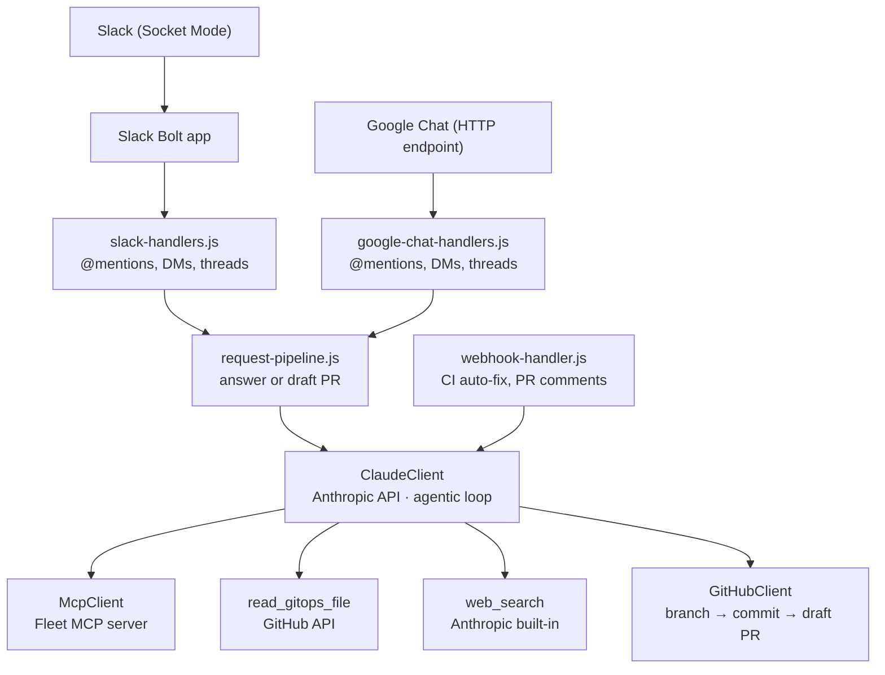

# Fleet Slackbot

A Slack or Google Chat bot that lets IT and security teams manage their [Fleet](https://fleetdm.com) deployment using plain English. Ask it questions about your fleet, or request configuration changes — it'll query live Fleet data and open a GitHub pull request with the necessary GitOps YAML changes.

## What it does

**Answer questions about your fleet**
> "How many macOS endpoints do we have?"
> "Which hosts are failing the disk encryption policy?"
> "Are any of my hosts exposed to CVE-2025-12345?"

The bot queries the live Fleet environment via the Fleet MCP server and responds directly in the chat.

**Propose configuration changes**
> "Add a policy to check that Firefox is installed on all workstations."
> "Set the minimum macOS version to 15.4 with a deadline of June 1."
> "Install 1Password on the servers team."

The bot generates the required GitOps YAML and opens a draft GitHub pull request for review.

**Auto-fix CI failures**
When a GitOps CI check fails on one of its PRs, the bot automatically reads the error, proposes a fix, and pushes a corrected commit.

## Architecture



Each process serves one chat platform, picked with `CHAT_PLATFORM` (`slack` by default, or `google-chat`). The GitHub webhook works the same on both.

## Setup

### 1. Chat app

Set up Slack or Google Chat.

#### Slack

Create a Slack app at [api.slack.com/apps](https://api.slack.com/apps) with:

- **Socket Mode** enabled (generates the App-Level Token)
- **Bot Token Scopes:** `chat:write`, `app_mentions:read`, `channels:history`, `groups:history`, `im:history`, `reactions:write`, `reactions:read`, `files:write`
- **Event Subscriptions:** `app_mention`, `message.im`

#### Google Chat

Requires a Google Workspace Business or Enterprise account.

1. In a Google Cloud project owned by your Workspace organization, enable the **Google Chat API** and note the **project number** (on the project dashboard).
2. Create a service account for the bot. Download a JSON key, or run on Google Cloud with the service account attached. No IAM roles or admin approval are needed: the bot only uses the `chat.bot` scope.
3. In **Google Chat API → Configuration**:
   - Set the app name, avatar URL, and description.
   - Set **Markup syntax** to **Markdown**.
   - Turn on **Interactive features**. Leave **Build this Chat app as a Google Workspace add-on** checked.
   - Under **Functionality**, check **Join spaces and group conversations**.
   - Under **Connection settings**, choose **HTTP endpoint URL**, check **Use a common HTTP endpoint URL for all triggers**, and enter `https://your-host/google-chat/events`.
   - Under **Visibility**, limit the app to the people or Google Groups who should manage Fleet.
4. Save. The page shows the add-on service account, `service-PROJECT_NUMBER@gcp-sa-gsuiteaddons.iam.gserviceaccount.com`. Its number should match `GOOGLE_CHAT_PROJECT_NUMBER`.

The bot accepts only requests signed for your project: add-on tokens must come from your project's add-on service account, and classic tokens must have your project number as the audience. If you build a classic (non-add-on) Chat app instead, set **Authentication Audience** to **Project number**. The **HTTP endpoint URL** audience isn't accepted, because those tokens don't identify the sending project.

How Google Chat differs from Slack:

- Chat apps can't add emoji reactions, so the status message in the thread shows progress and the final result.
- Reading thread history from the Chat API needs an admin-approved restricted scope. Instead, the bot remembers the last 10 messages of each thread it took part in (in a DM, the whole DM). This memory lives in the process and is cleared on restart.

### 2. GitHub

- Create a fine-grained personal access token with **read/write access to contents and pull requests** on your GitOps repo.
- Add a webhook on the repo pointing to `http://your-host:3000/github/webhook`, sending `Check runs`, `Issue comments`, and `Pull request review comments` events. Note the secret you choose.

### 3. Fleet MCP server

Run the [Fleet MCP server](https://github.com/fleetdm/fleet-mcp) and note its URL (default: `http://localhost:8181/sse`).

### 4. Environment variables

Copy `.env.example` to `.env` and fill in the values:

```
CHAT_PLATFORM=slack                              # or google-chat

# Slack (CHAT_PLATFORM=slack)
SLACK_BOT_TOKEN=xoxb-...
SLACK_APP_TOKEN=xapp-...

# Google Chat (CHAT_PLATFORM=google-chat)
GOOGLE_CHAT_PROJECT_NUMBER=123456789012
GOOGLE_CHAT_ENDPOINT_URL=https://your-host/google-chat/events   # exactly as entered in the Chat API console
GOOGLE_CHAT_CREDENTIALS={"type":"service_account",...}          # optional with Application Default Credentials
GOOGLE_CHAT_ALLOWED_DOMAINS=example.com                          # optional: only answer users with these email domains

GITHUB_TOKEN=github_pat_...
GITHUB_REPO=your-org/your-repo
GITHUB_BASE_BRANCH=main
GITHUB_WEBHOOK_SECRET=your-webhook-secret
GITHUB_BOT_USERNAME=your-bot-github-username   # used to ignore the bot's own PR comments
GITOPS_BASE_PATH=it-and-security                # path within the repo to the GitOps config

ANTHROPIC_API_KEY=sk-ant-...
ANTHROPIC_MODEL=claude-opus-4-6                  # optional, this is the default
MAX_TOOL_CALLS=100                               # safety cap on tool calls per response (default: 100)

FLEET_MCP_URL=http://localhost:8181/sse
PORT=3000                                        # port for the GitHub webhook and Google Chat listener

GITOPS_CI_CHECK_NAME=fleet-gitops               # name of the CI check to watch for auto-fix
CI_AUTO_FIX=true                                # set to false to disable CI auto-fix
```

### 5. Run

Requires Node.js 20 or newer (the test suite uses the built-in `node --test` runner).

```bash
npm install
npm start
```

## Usage

**In any channel or space:** `@Fleet how many Windows hosts do we have?`

**In a DM:** Just message the bot directly — no @mention needed.

**Follow-ups:** Reply in the same thread to refine a request. The bot uses earlier messages in the thread as context.
